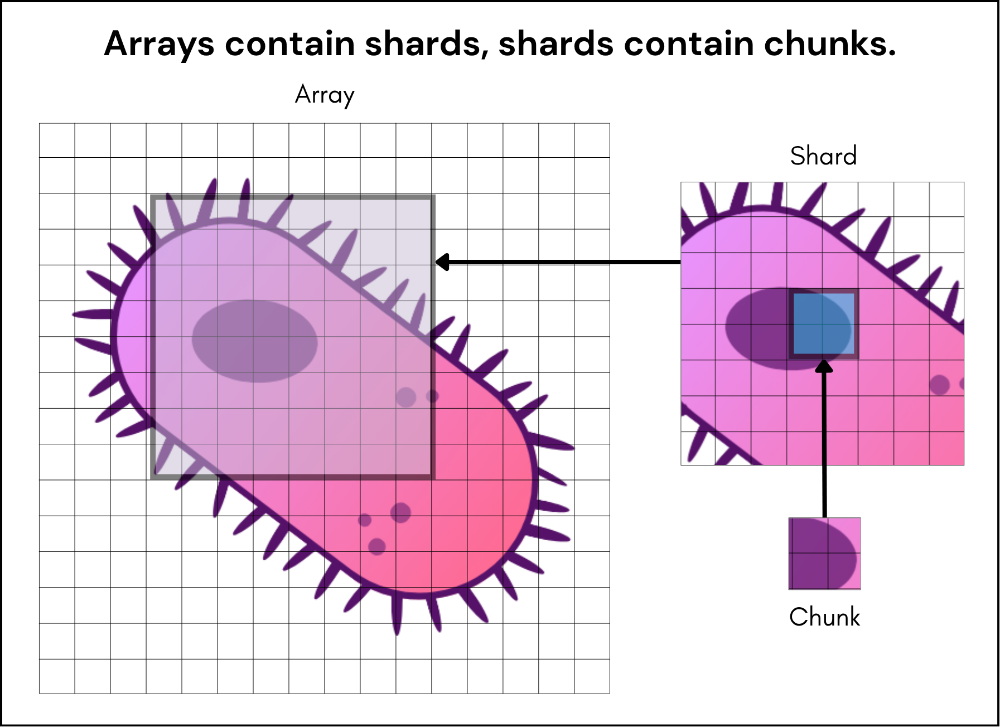
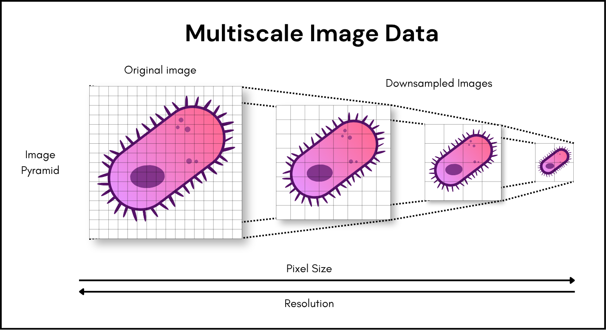

---
authors:
  - name: Kiya Govek
    github: govekk
    affiliation: The Jackson Laboratory
    role: Co-author
    date: "2026-11-03"
  - name: Virginie Uhlmann
    github: vuhlmann
    affiliation: University of Zürich
    role: Co-author
    date: "2026-11-03"
  - name: Genevieve Laprade
    github: glaprade
    affiliation: University of Zürich
    role: Co-author
    date: "2026-11-03"
  - name: Davide Bottone
    github: dv-bt
    affiliation: University of Zürich
    role: Co-author
    date: "2026-11-03"
  - name: Sebastian Rhode
    github: sebi06
    affiliation: ZEISS
    role: Co-author
    date: "2026-11-03"
  - name: Kevin Liu
    github: 
    affiliation:
    role: Co-author
    date: "2026-11-03"
  - name: Tiago Lubiana
    github: lubianat
    affiliation: German BioImaging e.V.
    role: Co-author
    date: "2026-11-03"
endorsers:
  - name: John Bogovic
    github: bogovicj
    affiliation: HHMI Janelia
    date: "2026-11-05"
reviewers:
  - name: Kimberly Meechan
    affiliation: UCL
    date: "2026-11-05"
manual_status: D3
description: Core Concepts
date: "2026-11-05"
---

# RFC 11: Core Concepts

Define concepts at the core of the OME-Zarr specification.

# Overview

This RFC defines the core concepts at the heart of OME-Zarr v1. Drawing on RFC-14, it provides normative definitions of the concepts on which the rest of the specification builds. A reader who is familiar with these concepts should therefore be prepared to engage with other RFCs and with the specification itself.
This RFC is intended to be a lean reference of the core concepts of the stable specification, that has been reviewed and endorsed through the RFC process. It does not aim to replace the explanatory and tutorial material that already exists, such as the [OME-Zarr book](https://ome-zarr-book.readthedocs.io/) and other [learning resources](https://ngff.openmicroscopy.org/resources/learning-and-teaching-material/index.html), to which readers can turn to for for further details and examples. 

# Background

The OME-Zarr specification is developed through the RFC process as described in [RFC-1](https://ngff.openmicroscopy.org/rfc/1/index.html). RFCs introduce new elements so that the specification as a whole is built up incrementally from the accepted RFCs. Beyond the changes they propose, RFCs also outline the context in which each element was introduced, including the problem it addresses and the motivation behind it. The RFCs are therefore essential to understanding the specification, but they are not a succinct entry point. Due to their comprehensiveness, the information needed to grasp the concepts RFCsthey introduce and rely on is often scattered across several of them. A reader who wants to understand the specification currently has to piece its core concepts together from multiple documents written at different times.
This gap was discussed at the [2025 OME-NGFF workflows hackathon](https://biovisioncenter.notion.site/2025-OME-NGFF-Workflows-Hackathon-25662fc04eb38148885ec0fee3ff8539) and within the OME-NGFF Editorial Board ([RFC-10](https://ngff.openmicroscopy.org/rfc/10/index.html)). This RFC addresses it by gathering the core concepts of the stable OME-Zarr specification version 1 (RFC-14) into a single document. Readers interested in the motivation behind each individual concept are referred to the RFCs that introduced them (referenced in the text), which this RFC does not replace. As the core concept definitions introduced here are part of an RFC, any future change to them will go through the same formal review process as the rest of the specification.

# Proposal

To be written

# Core Concepts

The primer to OME-Zarr core concepts below is built on an expected basic understanding of bioimage terminology and file systems. Refer to the [Introduction to Bioimage](https://bioimagebook.github.io/index.html) textbook for a more thorough introduction to bioimage concepts.

## 1. Zarr concepts

Since OME-Zarr uses the Zarr format to store pixel information from bioimages, it is necessary to first grasp the core Zarr concepts below. For more details on the Zarr format, see the [Zarr specification](https://zarr-specs.readthedocs.io/en/stable/specs.html).

### Zarr

A format for N-dimensional arrays stored as chunks.

### Hierarchy

A Zarr hierarchy is a tree structure, where each node in the tree is either a group or an array. Group nodes may have children but array nodes may not. The root of a Zarr hierarchy may be either a group or an array. In the latter case, the hierarchy consists of just the single array.

### Array

A Zarr array is an N-dimensional data structure which stores data of the same type.

### Group

A container for arrays and other groups, enabling hierarchical organization of data — similar to directories in a file system, or groups in HDF5. Like arrays, each group has its own metadata and attributes.

### JSON

JSON (JavaScript Object Notation) is a lightweight data-interchange format. A key-value pair in a JSON object is called a "property" or a "field".

> [!warning] 
> "Field" is used often in the OME-Zarr to refer to a JSON property, but may also appear in the context of HCS as a "field" or "field of view".

### `zarr.json`

Array metadata documents and group metadata documents are stored under the key `zarr.json` within the prefix of the array or group.

### Store

A key-value storage backend that holds Zarr data and metadata. Examples include local file systems and cloud object storage. 

### Chunk

The fundamental unit of data in a Zarr array. An array is divided into chunks along each dimension according to the chunk grid. The chunks are the smallest units that can be read independently.

### Shard

A storage object that contains one or more chunks. Sharding reduces the number of objects in a store by grouping chunks together, which may improve performance on file systems and object storage.

### Codec

A way to encode/decode data using algorithms that, for example, compress the data in particular ways.
In Zarr, multiple codecs are available. Tools are only able to read (*decode*) data that was written (*encoded*) with a codec both readers and writers understand.

### Compression

The process of algorithmically encoding data to require fewer bits of information. A compression algorithm may be either lossy or lossless. A codec may implement a compression algorithm.

### Lossy vs Lossless compression

Lossy compression discards some information and, as a result, is irreversible: un-compressed data only ever approximate their original version. Lossless compression retains all information and is thus reversible, it allows the original data to be reconstructed exactly from their compressed version.

## 2. OME and NGFF concepts

NGFF (Next-Generation File Format) in the context of the Open Microscopy Environment is a community-driven process to define shared specifications, metadata standards, and best practices in the pursuit of standardization, better scalability, and interoperability for microscopy data. The following concepts are necessary to understanding that community and process.

### Open Microscopy Environment (OME)

OME is a consortium of universities, research labs, industry, and developers producing open-source software and format standards for microscopy data.

### OME data model

The OME data model is a specification for storing biological imaging metadata. The model includes image parameters, such as XYZ dimensions and pixels type, as well as extensive metadata on, for example, image acquisition, annotation, and regions of interest (ROIs). OME-Zarr stores the OME metadata in JSON format.

### Next-Generation File Format (NGFF)

NGFF is the community-driven process for designing the next generation of bioimaging formats.

### Request for Comment (RFC)

RFCs structure high-level discussions on changes within the NGFF community and record outcomes including key opinions, actions, and decisions.

### Specification (spec)

Definition of an OME-Zarr version which includes storage hierarchy conventions and metadata requirements or options.

### Transitional metadata

Transitional metadata is added to the specification with the intention of removing it in the future. Implementations may be expected to support the reading of these metadata, but writing will usually be optional.

## 3. OME-Zarr core

OME-Zarr is the file format that the NGFF community has settled on. The following concepts are helpful for reading the [OME-Zarr specification](https://ngff.openmicroscopy.org/specifications/index.html).

### Versioning

OME-Zarr version and Zarr version are not linked but are related: OME-Zarr < v0.5 uses Zarr v2; OME-Zarr v0.5 and beyond use Zarr v3. 

### Image pyramid / Multiscale

Pyramidal image files (also known as multiscale images) store the same image at multiple different resolution levels. In the context of multiscales, the original image is the highest (full) resolution level. This image is downsampled to lower resolutions to create the image pyramid.

### Channel

<!-- A signal component in an image, represented as an axis in the array. Think of it as one layer of measurements about the same sample.-->

A channel is a layer that contains a single readout for each positional element (pixel) of the image array. An array may combine multiple channels along a dedicated axis.

> [!warning]
> - A single-channel image may omit the channel axis or retain it with a length of one.
> - For RGB images, each color is saved as a separate channel in OME-Zarr.

> [!tip] Example
> | Channel index | Example signal | What it helps show |
> | :---: | :---: | :---: |
> | 0 | A DNA stain | Cell Nuclei |
> | 1 | A membrane stain | Cell Boundaries |
> | 2 | A fluorescent protein marker | Marker's distribution |

### Axis

Image arrays in OME-Zarr are arrays of 2 or more dimensions. Each dimension is described in the `axes` metadata, which also provides extra information about what each dimension represents. For example, a name, a type (e.g., space, time, channel), and a unit (e.g., micrometer, nanometer, millisecond).

### Reader

A tool that reads and interprets image data and metadata stored in an OME-Zarr according to a specified version.

### Writer

A tool that creates or updates image data and metadata in OME-Zarr according to a specified version.

### Viewer

An tool that uses a reader to render OME-Zarr image(s) and display the pixels and metadata they contain for human interaction and inspection.

### Converter

A tool that translates image data and metadata between formats or specification versions, including into or from OME-Zarr.

### Validator

A tool that checks an OME-Zarr against the requirements it implements for a specified version and reports detected errors or inconsistencies.

## 4. Coordinate transformations (RFC 5)

Coordinate systems and transformations were introduced to the OME-Zarr specification in [OME.Zarr v0.6](https://ngff.openmicroscopy.org/specifications/0.6/index.html). The following concepts, along with a basic understanding of linear algebra, will be helpful to read that specification. For more information on motivation and specific types of transformations, see [RFC-5](https://ngff.openmicroscopy.org/rfc/5/index.html).

### Coordinate transformation

A coordinate transformation is a function that describes the relationship between two coordinate systems. Coordinate transformations operate as a rule in the forward direction, that is from one input coordinate system to an output coordinate system. If the inverse transformation exists (output → input), the coordinate transformation is invertible.

> [!tip] Types of coordinate transforms
> Different kinds of coordinate transformations can be specified in OME-Zarr. Common families are *matrix transformations* (rotation and affine transformations), that are parametrized by matrices, and *displacement transformations*, where the coordinate transformation is represented by a vector field.

### Array space

Every array has a default array coordinate system, with one axis per array dimension, no units, default names (`dim_0`, `dim_1`, ...), and the array's path as its name.

### Physical space

A coordinate system whose axes carry real-world meaning, such as space in micrometers or time in seconds. A coordinate transformation links physical space to array space.

### Sequence / composition

An ordered list of transformations applied first to last, with each output feeding the next.

### Scene

A scene groups spatially related images and describes their relative placement through transformations between coordinate systems. Its metadata must include coordinate transformations and may define additional coordinate systems, such as a shared reference frame.

> [!warning]
> If adopted as currently proposed, RFC-8 would represent scene metadata as an attribute of a collection, enriching that collection with spatial relationships between its images.

## 5. Extensions and Collections

OME-Zarr defines extension points and a generic definition of collections to accommodate collections of related data that result from scientific imaging and workflows. See [RFC-8](https://ngff.openmicroscopy.org/rfc/8/index.html) for more information, motivation, and user stories.

### Extension

Defined points for adding non-essential functionality and features.

### Collection

Collections are arbitrary groups of nodes which can be specialised for different use cases. Collections can be segmentations, prediction maps and other derived images as well as other data types ("nodes").

> [!tip] Info
> A grouping of images or other data that can contain nested collections independently of physical storage layout.
> Collection = grouping; scene metadata = spatial relationships within that grouping.

### Path

A typed storage location that tells software where and how to access an object's metadata, using a relative location, an absolute file URI, or a remote URL.

### Nodes

The Node interface is a consistent JSON structure for several different types of OME-Zarr metadata object, where fields specific to the node type are inside an attributes field, and the root only stores information used for identifying and referencing the object.

### Trait

A set of metadata that describes a node's role or properties, such as identifying a collection as a plate or well.

### Label image

An image whose pixel or voxel values are non-negative integers representing labels with defined meanings, such as individual object identifiers or classes. It is spatially associated with a corresponding multiscale image.

> [!tip] Labels and segmentation
>- In *instance segmentation*, a label value typically identifies an individual object. In *semantic segmentation*, a label value identifies a class and may occur across multiple objects.
>- One value may cover several disconnected regions, but one pixel in one label image cannot hold two independent object IDs simultaneously.

## 7. High-content screening (HCS)

Due to their structure, it is helpful to store high-content screening datasets in OME-Zarr using a pre-defined hierarchy structure. The description of that structure in the OME-Zarr spec and [RFC-8](https://ngff.openmicroscopy.org/rfc/8/index.html) is based on the following concepts.

### High-content screening (HCS)

An automated microscopy workflow that acquires and analyzes images from many samples.

### Plate

A plate is a sample carrier containing a grid of wells, characterized by its number of rows and columns, well geometry and spacing, bottom material, and skirt design.

### Well

A well is an individual sample-holding compartment within a plate, identified by its row and column, with its shape and position determined by the plate design.

### Row and column

The two grid coordinates used to locate a well within a plate, such as row A and column 1 for well A1.

> [!tip] Indexing
> Indices are zero-based positions of a well's row and column in the plate's declared `rows` and `columns` lists; for example, well A1 has `rowIndex: 0` and `columnIndex: 0` when A and 1 are the first entries in those lists.

### Field and field of view (FOV)

Commonly refers to the region visible to the microscope at a given position. In the context of HCS, a well may contain several distinct fields; one field need not cover the whole well.

### Acquisition

An acquisition is a distinct imaging run covering some or all wells of a plate, with the images collected during that run grouped under a shared acquisition identifier.

### Grid

A grid is a two-dimensional arrangement of positions organized into rows and columns, used to locate samples, sample regions, or images without requiring wells or every position to be occupied.

> [!tip] Use cases
> A grid can organize sample-holding wells in a multiwell plate or tissue cores in a tissue/tumor microarray (TMA) section, where no separate sample-holding compartments are present.

## 8. Single file packaging

Typically, a single image stored in OME-Zarr format would be represented as multiple objects or files, which can be prohibitive for some applications or adoption. OME-Zarr supports the use of a zipped format such that a single file stores the whole Zarr hierarchy. For motivation and specifics, see [RFC-9](https://ngff.openmicroscopy.org/rfc/9/index.html).

### ZIP

A widely used format that bundles many files and folders into a single file.

### Single-file OME-Zarr (`*.ozx`)

An OME-Zarr dataset packaged in one ZIP archive, preserving its image data, metadata, and internal hierarchy. It can contain a single image or a larger dataset, such as an HCS plate.

The root-level `zarr.json` sits directly at the archive root. This makes the dataset easier to copy and share as one file and open with compatible software.

## References

https://zarr-specs.readthedocs.io/en/latest/v3/core/index.html

https://zarr.readthedocs.io/en/stable/user-guide/

https://www.openmicroscopy.org/

https://ome-model.readthedocs.io/en/stable/

https://ngff.openmicroscopy.org/help-desk/

https://ngff.openmicroscopy.org/rfc/1/index.html

https://ngff.openmicroscopy.org/rfc/8/index.html

https://ngff.openmicroscopy.org/specifications/0.6/index.html#axes-metadata

https://ngff.openmicroscopy.org/specifications/0.4/index.html#document-conventions

https://github.com/ome/ngff-rfc8-revisions/blob/main/rfc8_revision_changes.md

https://www.json.org/json-en.html

https://json-schema.org/understanding-json-schema/reference/object#properties

https://bioimagebook.github.io/chapters/1-concepts/6-files/files.html#pyramidal-images 