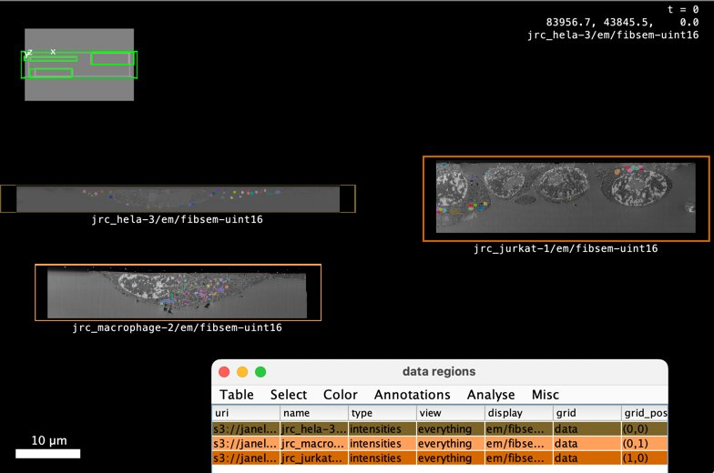

---
authors:
  - name: Norman Rzepka
    github: normanrz
    affiliation: scalable minds
    role: Co-author
    date: "2024-11-20"
  - name: Eric Perlman
    github: perlman
    affiliation: Yikes LLC
    role: Co-author
    date: "2024-11-20"
  - name: Joel Lüthi
    github: jluethi
    affiliation: BioVisionCenter Zurich
    role: Co-author
    date: "2024-11-20"
  - name: Lorenzo Cerrone
    github: lorenzocerrone
    affiliation: BioVisionCenter Zurich
    role: Co-author
    date: "2024-11-20"
  - name: Christian Tischer
    github: tischi
    affiliation: EMBL
    role: Contributor
    date: "2025-02-01"
  - name: Matthew Hartley
    github: matthewh-ebi
    affiliation: EMBL-EBI
    role: Contributor
    date: "2025-05-05"
  - name: Johannes Soltwedel
    github: jo-mueller
    affiliation: German BioImaging e.V.
    role: Co-author
    date: "2025-10-28"
  - name: Damien Goutte-Gattat
    github: gouttegd
    affiliation: German BioImaging e.V.
    role: Co-author
    date: "2026-10-22"
  - name: Draga Doncila Pop
    github: DragaDoncila
    affiliation: Image Cooperative
    role: Co-author
    date: "2026-11-10"
  - name: Juan Nunez-Iglesias
    github: jni
    affiliation: Image Cooperative
    role: Co-author
    date: "2026-11-10"
manual_status: R1
description: Collections
date: "2026-11-17"
---

# RFC-8: Collections and Extensibility
(rfcs:rfc8:version2)=

```{toctree}
:hidden:
:maxdepth: 1
comments/index
versions/index
```

Extending OME-Zarr with new metadata types, references, and collections

## Status

```{rfc-status}
```

## Overview

<!--
The RFC begins with a brief overview. This section should be one or two
paragraphs that just explains what the goal of this RFC is going to be, but
without diving too deeply into the "why", "why now", "how", etc. Ensure anyone
opening the document will form a clear understanding of the RFCs intent from
reading this paragraph(s).

-->

This proposal introduces a general extensibility mechanism for OME-Zarr
metadata. It defines a common Node interface, a system for referencing nodes
by path, and an extension scheme that allows OME-Zarr to be extended
with new node types and metadata while maintaining interoperability.

The mechanism also provides a general way to represent collections: groups of
images and other data objects that can be nested, referenced, and enriched with
additional metadata. Existing concepts such as multiscales, labels, HCS
layouts, and coordinate transformations can be represented within this
framework, while future extensions can introduce additional data types and use
cases.

This proposal does not aim to define all possible extensions or metadata types.
Instead, it establishes the building blocks and extension points through which
OME-Zarr can evolve in a controlled and interoperable manner.

## Background

Scientific imaging increasingly involves collections of related data rather
than isolated images. A single experiment may produce multiple images of the
same sample, images acquired with different modalities or from different views,
derived images such as segmentations and prediction maps, and additional data
such as tables or meshes. These data may have relationships that are important
for interpreting them: they may share a coordinate space, originate from the
same acquisition, represent different stages of a processing workflow, or
need to be visualized together.

OME-Zarr already provides mechanisms for several of these use cases. For
example, labels can be associated with images, high-content screening data can
be organized into plates and wells, and RFC-5 provides coordinate systems and
transformations for relating images in a common coordinate space. The
bioformats2raw.layout metadata provides another way of organizing series of
images. However, these mechanisms have developed around individual use cases
and consequently provide different structures and conventions for representing
related data.

At the same time, applications have developed their own metadata formats for
grouping images and describing their relationships. Viewers such as Webknossos,
Neuroglancer, MoBIE and OMERO.figure can display multiple images together and
have developed JSON-based metadata to describe those collections, including
path references, coordinate transformations and rendering settings. Workflow
systems may need to associate input images with derived outputs without
modifying the original data. Archives need to describe collections of images
during both deposition and subsequent access. Similar needs arise for gallery
and grid views, correlative imaging, and images published at remote locations.

This fragmentation makes it difficult to exchange collections of scientific
data between tools. Users may need to maintain tool-specific metadata for the
same underlying relationships, while archives and other data providers may need
to produce multiple representations of the same collection for different
consumers. A general mechanism for describing related objects would allow these
use cases to be represented consistently while leaving application-specific
metadata to the applications that need it.

Extensibility is important because the range of scientific data and workflows
cannot be anticipated in a single specification. In addition to images and
segmentations, workflows may produce prediction maps, tables, meshes and other
derived data. Similarly, different applications may need to attach metadata
describing rendering state, processing context, or other relationships between
objects. Rather than defining a separate top-level mechanism for every new use
case, OME-Zarr should provide well-defined extension points through which new
node types and metadata can be introduced while maintaining interoperability.

Several existing standards could potentially be used to represent such
collections. For example, Research Object Crate (RO-Crate) provides a general
mechanism for describing collections of research artifacts and their
relationships, while JSON-LD provides standardized mechanisms for types,
identifiers and extensibility. These approaches provide useful capabilities,
but they also introduce requirements and complexity that are not well matched
to the requirements of OME-Zarr. In particular, path-based references to Zarr
and JSON metadata, including relative paths and different path types, are
central to this proposal. A purpose-built mechanism can retain the
human-readable and storage-oriented characteristics of OME-Zarr while providing
the extensibility needed by its users.

The goal of this proposal is therefore not simply to introduce another
collection format. It is to provide a common and extensible foundation for
representing OME-Zarr objects and their relationships. Collections are an
important application of this foundation: they allow images and other objects
to be grouped, nested, referenced by path, and enriched with
additional metadata. The same mechanism can also provide a path for
incorporating existing OME-Zarr structures and future data types into a more
consistent framework.

## Proposal

The following sections describe the proposed metadata framework in detail. They
define the building blocks, the abstract structure, and the core classes in
order. Each section includes schemas and small illustrative examples intended
to explain the structure and relationships between the different components.

The examples in these sections are deliberately minimal and focus on
illustrating individual aspects of the proposal, e.g.:


```jsonc
{
    "ome": {
        "version": "0.x",
        "type": "multiscale",
        "id": "000001",
        "name": "our_first_example",
        "data": [
          {
            "name": "s0",
            "type": "array",
            "path": {
              "type": "zarr",
              "format": "relative",
              "href": "./s0"
            }
          }
        ]
    }
}
```

More complete examples showing how these components can be combined to support
the use cases described in the Background are provided later in the document.

### Features deferred to subsequent sub-RFC

This RFC will defer the definition of some features to forthcoming sub-RFCs.
In doing so, we aim to help reviewers focus on providing feedback on the core building blocks being defined in this RFC.
In parallel to the review of RFC-8, we will author sub-RFCs for each deferred feature that propose how they will be expressed using the core RFC-8 building blocks defined in this document.
As we iterate on the design of RFC-8, we will update the sub-RFCs.
All deferred features will be proposed and evaluated via the RFC process before the v1.0 specification is released.

The following features are being deferred to sub-RFCs:

| Topic | Scope |
|---|---|
| **HCS** | Plate and well traits |
| **Labels** | Label image traits and per-label properties |
| **bioformats2raw and OME-XML** | Series layout and the OME/METADATA.ome.xml mapping |
| **Absolute and remote references** | Absolute paths and URLs, authentication and security |
| **snake_case** | Making keys and identifiers consistent with Zarr |
| **Legacy multiscales** | A `legacy_multiscale` node type for unchanged 0.5 and 0.6 images |
| **Singlescale images** | A node type for images with a single resolution level |

### Building blocks

The building blocks define how objects are represented using paths, declarations and references.

(rfcs:rfc8:path-interface)=
#### `Path` interface

This new interface replaces the paths defined in the previous versions of the
OME-Zarr specification.

(rfcs:rfc8:path-interface-example)=
##### Example

From our first example, this is the lowest level type
used to build up the definition of an image.

```jsonc
    "path": {
        "type": "zarr",
        "format": "relative",
        "href": "./s0"
    }
```

(rfcs:rfc8:path-interface-schema)=
##### Schema

| Field | Type | Required? | Notes |
| - | - | - | - |
| `"type"` | string | yes | Value MUST be a valid path type. |
| `"format"` | string | yes | Value MUST be a valid path format. See below. |
| `"href"` | string | yes | Value MUST be a string containing a path in the declared `format`. See below. |

(rfcs:rfc8:path-interface-field-type)=
##### Field: `type`

The `type` field of a `Path` object defines how the path is interpreted. This RFC defines two path types: `zarr` and `json`:

- The `"zarr"` type is used for paths that reference nodes in a Zarr array or
  group. Implementations MUST append `zarr.json` to the path to access the
  metadata of the referenced node.
- The `"json"` type is used for paths that reference nodes in an arbitrary JSON file.

The `type` field of a `Path` object is an extension point. For detail on how to extend the `type` field with new values, see [Extensions](#extensions).

(rfcs:rfc8:path-interface-field-format)=
##### Field: `format`

The `format` field of a `Path` object declares how the `href` string is to be interpreted.
Implementations MUST use the `format` field to interpret the `href` and MUST NOT infer the format from the `href` string itself (e.g. from a `file://` or `https://` prefix).

The following path formats are defined:

| Format | Defined in | Description |
| - | - | - |
| `"relative"` | this RFC | A path relative to the metadata document that contains the `Path` object. |

Only `relative` is a core path format of this RFC.
Implementations that do not support the declared `format` MUST NOT attempt to resolve the path and SHOULD treat the referenced node as unavailable.

Future RFCs may propose additional path formats, such as S3 URLs or chained paths (e.g. for referencing files within a zip file).

(rfcs:rfc8:path-interface-field-href)=
##### Field: `href`

The `href` string locates the referenced document in the declared `format`.
This RFC defines the rules for `href` values with the `relative` format only.

- Relative paths are resolved from the location of the metadata document that contains the `Path` object,
  i.e. from the Zarr group whose `zarr.json` contains it, or from the directory of the standalone JSON file that contains it.
- Relative paths follow the relative path notation defined in [IETF RFC1808](https://datatracker.ietf.org/doc/html/rfc1808).
  Briefly, `.` and `..` are used to navigate the hierarchy and the hierarchy is separated by `/`.
- Relative paths may be used for data stored on traditional file systems as well as other storage protocols, such as HTTP or S3.
  The storage protocol is determined by how the containing document was accessed, not by the `href`.

Examples:
- `./image.ome.zarr`
- `../image.ome.zarr`
- `./registered/em.ome.zarr`
- `s0`

See the [Security](#security) section for guidance on access restrictions.

(rfcs:rfc8:path-interface-resolution)=
##### Path resolution

Resolving a node's `path` means loading the document it locates, and, if the root node of that document has child nodes with a `path`, resolving those in turn.
Resolving node paths MUST NOT form a cycle: a node's `path` MUST NOT resolve to a document that contains that node, directly or through a chain of other node paths.
Implementations MUST detect cycles and MUST stop resolving and report an error when they encounter one.

This rule applies to the `path` fields of nodes.
The `path` field of a [`Reference`](#reference-interface) only locates the document that contains the referenced object and MAY point back to an enclosing document, e.g. from a resolution level to the coordinate systems of its multiscale.

(rfcs:rfc8:ids)=
#### IDs

IDs identify the objects that are declared with the [`Declaration` interface](#declaration-interface).
All IDs MUST follow these rules:

- IDs MUST be non-empty strings.
- IDs MUST only use characters in the sets `a-z`, `A-Z`, `0-9`, `-`, `_` and `.`.
- IDs MAY be UUIDs, in which case they SHOULD be UUIDv7+, e.g. `01a13520-b697-70c4-979b-b52c01fbbe30`.
- IDs SHOULD NOT encode semantics, such as the name, type or location of the declared object, because such information may change while the ID needs to stay stable (see [McMurry et al. 2017](https://doi.org/10.1371/journal.pbio.2001414)).
  Human-readable information belongs in other fields, e.g. `name`.

For readability, the examples in this document use short IDs such as `"000001"`.

(rfcs:rfc8:declaration-interface)=
#### `Declaration` interface

Every object that can be referenced is declared exactly once.
A declaration is the place where an object's `id` and its other fields are defined, e.g. an entry in a `nodes` or `coordinateSystems` array.

Every declaration MUST have the following fields:

| Field | Type | Required? | Notes |
| - | - | - | - |
| `"type"` | string | yes | Value MUST be the kind of the declared object, e.g. `"collection"` or `"multiscale"` for nodes and `"coordinate_system"` for coordinate systems. |
| `"id"` | string | yes | Value MUST be the identifier of the declared object. IDs MUST be unique within the JSON document where they are defined. IDs MUST follow the [ID rules](#ids). |

Additional fields, traits and child nodes of an object are defined on its declaration.
Everywhere else, the object is referred to with a [`Reference`](#reference-interface).
Declarations use the `id` key and references use the `ref` key, so that a declaration can always be distinguished from a reference.

(rfcs:rfc8:reference-interface)=
#### `Reference` interface

The `Reference` interface is a consistent system for referring to OME-Zarr metadata objects.
A reference points to an object that is [declared](#declaration-interface) elsewhere, e.g. in the `input` and `output` fields of coordinate transformations.
A reference is either a string (the short form) or an object (the full form).

(rfcs:rfc8:reference-interface-example)=
##### Example

A reference to a coordinate system that is declared in the same document, in the short form:

```jsonc
"output": "000002"
```

The same reference in the full form:

```jsonc
"output": { "type": "coordinate_system", "ref": "000002" }
```

A reference to a coordinate system that is declared in another document:

```jsonc
"input": {
  "type": "coordinate_system",
  "path": { "type": "zarr", "format": "relative", "href": "./raw" },
  "ref": "000005"
}
```

(rfcs:rfc8:reference-interface-schema)=
##### Schema

A reference MUST be either a string or an object.

String references MAY be used for convenience and are subject to the following requirements:

- A string reference MUST be the `id` of a declaration in the current metadata document.
- A string reference MUST only be used if the field that holds it unambiguously determines the `type` of the referenced declaration, e.g. the `output` field of a `coordinateTransformation` unambiguously references a `coordinateSystem` declaration somewhere.

A string reference is equivalent to an object reference whose `type` is the type determined by the field holding the reference, whose `ref` is the string, and which has no `path`.

An object reference MUST have the following fields:

| Field | Type | Required? | Notes |
| - | - | - | - |
| `"type"` | string | yes | Value MUST be the `type` of the referenced declaration. |
| `"ref"` | string | yes | Value MUST be the `id` of the referenced declaration. |
| `"path"` | object | no | Value MUST be a `Path` object locating the document that contains the referenced declaration. |

An object reference MUST NOT contain any other fields.
In particular, a reference MUST NOT carry traits or child nodes; these belong to the declaration.

(rfcs:rfc8:reference-interface-resolution)=
##### Resolution

- A string reference is resolved within the current metadata document.
- If the `path` of an object reference is absent, `ref` is resolved within the current metadata document.
- If the `path` of an object reference is present, `ref` is resolved within the metadata document that `path` locates.
- The resolved declaration MUST have the `type` that the reference names or, for a string reference, the type that its field determines.
  Implementations MUST report an error if no declaration with the given ID exists in the resolved document, or if its `type` does not match.

(rfcs:rfc8:abstract-structure)=
### Abstract structure

The proposal introduces a common Node structure for different types of OME-Zarr
metadata objects. Nodes can represent images or collections, and can be nested
or referenced by path. Collections provide a mechanism for grouping nodes and
may have metadata attached to them, while nodes may carry additional metadata
describing their role within a collection. Images may be added as
nodes to multiple collections. Arbitrary user or implementation metadata may be
added to collections or nodes, which is an opportunity to add metadata that is
only valid for a node in the context of a collection (e.g. rendering settings).

(rfcs:rfc8:abstract-structure-node)=
#### `Node` interface

This RFC defines a basic interface for an OME-Zarr metadata object, which we
name `Node`. The [Node interface](#node-interface) is a consistent JSON structure for
several different types of OME-Zarr metadata object and the root only stores
information used for identifying and referencing the object.

Nodes conform to the [`Declaration` interface](#declaration-interface) and therefore require the `type` and `id` fields.

(rfcs:rfc8:abstract-structure-node-schema)=
##### Schema

Objects that implement `Node` have the following fields:

| Field | Type | Required? | Notes |
| - | - | - | - |
| `"type"` | string | yes | Value MUST be a string identifying the node type. |
| `"id"` | string | yes | Value MUST be the identifier of the declared object. IDs MUST be unique within the JSON document where they are defined. IDs MUST follow the [ID rules](#ids). |
| `"name"` | string | no | Value MUST be a non-empty string intended for human-readable display. |
| `"version"` | string | root node only | Value MUST be the version of the OME-Zarr specification. Required on the root node of a metadata document. See [Field: `version`](#field-version). |
| `"extensionManifest"` | array | root node only | Value MUST be an array of extension objects. Required on the root node of a metadata document that uses extensions. See [Extension manifest](#extension-manifest). |
| `"traits"` | array | no | Value MUST be an array of `Trait` objects. [See traits section](#traits). |

(rfcs:rfc8:abstract-structure-node-field-type)=
##### Field: `type`

The `type` field of a `Node` defines its structure and semantics, including any additional fields it might have.
Additional functionality of a node can be expressed through its [traits](#traits).
This RFC defines two node types: `collection` and `multiscale`.
A third kind of object, the `array`, is not a node type: `array` objects are stored in the `data` field of a `multiscale` node.

The `type` field of a `Node` is an extension point. For detail on how to extend the `type` field with new values, see [Extensions](#extensions).

(rfcs:rfc8:abstract-structure-node-field-version)=
##### Field: `version`

The root node of a metadata document, i.e. the `Node` object stored directly under the `ome` key, MUST have a `version` field, as defined in previous spec versions.
Non-root `Node` objects, e.g. those declared in the `nodes` field of a `collection` node,
SHOULD NOT have a `version` field and MUST NOT have a different `version` value than the root `Node`.

(rfcs:rfc8:abstract-structure-node-field-extensionManifest)=
##### Field: `extensionManifest`

The root node of a metadata document MUST have an `extensionManifest` field if the document uses extension-defined custom types.
Non-root `Node` objects MUST NOT have an `extensionManifest` field.
See [Extension manifest](#extension-manifest) for its contents.

(rfcs:rfc8:abstract-structure-traits)=
#### Traits

Each `Node` has a `traits` field that accepts a list of `Trait` objects.
The node type and the traits of a node have separate roles.
The node type defines the structure of a node: which fields it has and how readers traverse it and resolve its children.
Traits define the function of a node: what the data represents and how it relates to other nodes, e.g. that a collection is a plate, a well or a scene, or that an image contains labels.
A node may carry any number of traits, so independent aspects can be combined on the same node without defining a new node type for each combination.

Each trait has minimally a `type` field, which dictates how the trait should be interpreted and defines the other fields it may contain.
Trait fields are stored inside the trait object, not on the node.
Readers that do not understand a trait MAY ignore it and still traverse the node based on its node type.

This RFC defines one type of trait: [`scene`](#scene-trait).

Trait types are also an extension point, so any extension can define its own traits following the rules set forth in the [“Extensions” section](#extensions).

#### Metadata storage

##### OME-Zarr group

Node metadata may be stored in the `ome` key of the `attributes` container in a `zarr.json` file of a Zarr group.
This is particularly useful for defining the nodes that are stored within a Zarr group. However, there is no limitation to only reference nodes within the Zarr group.

```jsonc
{
  // zarr.json
    "zarr_format": 3,
    "node_type": "group",
    "attributes": {
        "ome": {
            "version": "0.x",
            // Our `collection`-typed node fields
            // are listed here
            "type": "collection",
            "id": "000001",
            "name": "zarr.json-example",
            "nodes": [...]
        }
    }
}
```

##### Standalone JSON

Node metadata may also be stored in standalone JSON files that are stored in arbitrary locations and have a file name ending in `.json`.
Here, the metadata is stored in the `ome` key of the root object.
Standalone files are useful for persisting groupings of images that may or may not be stored in the same folder hierarchy.

```jsonc
{
  // an arbitrary json
    "ome": {
        "version": "0.x",
        // Our `collection`-typed node fields
        // are listed here
        "type": "collection",
        "id": "000001",
        "name": "standalone-example",
        "nodes": [...]
    }
}
```

(rfcs:rfc8:metadata-storage-consolidated)=
##### Consolidated metadata (non-normative)

This section is non-normative.

Resolving a tree of path-referenced nodes requires fetching the `zarr.json` of each referenced Zarr group (see [Performance](#performance)).
To reduce the number of requests, writers MAY use [Zarr consolidated metadata](https://github.com/zarr-developers/zarr-specs/pull/309) to bundle the `zarr.json` documents of referenced nodes into the `zarr.json` of the root group.
Consolidated metadata stores a copy of the `zarr.json` of every group and array below the root group as a flat mapping, keyed by the path relative to the root group.
A reader that supports consolidated metadata can then load the whole tree in a single request.
This also applies to nested collections: their `zarr.json` documents may be consolidated into the root, while they remain separate documents with their own `ome` metadata.

```jsonc
{
  // zarr.json of the root group
    "zarr_format": 3,
    "node_type": "group",
    "attributes": {
        "ome": {
            "version": "0.x",
            "type": "collection",
            "id": "000001",
            "name": "consolidated-example",
            "nodes": [
                {
                    "type": "multiscale",
                    "id": "000002",
                    "name": "image",
                    "path": { "type": "zarr", "format": "relative", "href": "./image" }
                }
            ]
        }
    },
    "consolidated_metadata": {
        "kind": "inline",
        "must_understand": false,
        "metadata": {
            "image": {
                // copy of ./image/zarr.json
                "zarr_format": 3,
                "node_type": "group",
                "attributes": { "ome": { ... } }
            },
            "image/s0": {
                // copy of ./image/s0/zarr.json
                "zarr_format": 3,
                "node_type": "array",
                ...
            }
        }
    }
}
```

The individual `zarr.json` files remain the source of truth.
The consolidated copy is only a cache, and it can go stale when a referenced node is modified without updating the root.
Readers that support consolidated metadata use the consolidated copy when it is present, so they see outdated metadata until the root is consolidated again.
Keeping the cache consistent with the individual files would require an external transaction system, such as [Icechunk](https://icechunk.io) or a custom database.

Consolidated metadata is a pure Zarr mechanism, and this RFC adds no OME-specific rules to it.
Readers that do not support consolidated metadata fetch the `zarr.json` of each referenced node as usual.
Consolidated metadata can only cover Zarr nodes within the hierarchy of the root group; standalone JSON files and nodes outside the root group are always fetched individually.

At the time of writing, the Zarr-level specification of consolidated metadata is incomplete, which limits what this RFC can say about it.
A future revision may give more guidance once the Zarr specification is finalized.

### New and modified core classes

Building on the core building blocks and the abstract structure, the following
sections define concrete node types for collections and
multiscale images, and integrate coordinate systems and transformations from
RFC-5.

(rfcs:rfc8:collection-node)=
#### `Collection` node

[Collections](#collection-node) are arbitrary groups of `Node`s which can be
specialised for different use cases. Collections can be used to group together
images, including segmentations, prediction maps and other derived images as
well as other data types ("nodes"). Collections can be nested. Collections can
have metadata attached, and nodes within a collection can also have node-level
metadata. Nodes within collections are referenced by paths instead of relying
on a specific file system hierarchy.

(rfcs:rfc8:collection-node-schema)=
##### Schema

| Field | Type | Required? | Notes |
| - | - | - | - |
| `"type"` | string | yes | Value MUST be `"collection"`. |
| `"id"` | string | yes | Value MUST be the identifier of the declared object. IDs MUST be unique within the JSON document where they are defined. IDs MUST follow the [ID rules](#ids). |
| `"name"` | string | no | Value MUST be a non-empty string intended for human-readable display. |
| `"version"` | string | root node only | Value MUST be the version of the OME-Zarr specification. Required on the root node of a metadata document. See [Field: `version`](#field-version). |
| `"extensionManifest"` | array | root node only | Value MUST be an array of extension objects. Required on the root node of a metadata document that uses extensions. See [Extension manifest](#extension-manifest). |
| `"nodes"` | array | no | Value MUST be an array of `Node` objects. |
| `"path"` | object | no | Value MUST be a `Path` object. |
| `"traits"` | array | no | Value MUST be an array of `Trait` objects. [See traits section](#traits). |

Either `"nodes"` or `"path"` MUST be present, but not both.

If `"path"` is present, the document it resolves to MUST have a root node of type `collection`.

```jsonc
{
  "ome": {
      "version": "0.x",
      "type": "collection",
      "id": "000001",
      "name": "proj_gallery",
      "nodes": [{
          "type": "collection",
          "id": "000002",
          "name": "gallery1",
          "path": {
            "type": "json",
            "format": "relative",
            "href": "../gallery.json"
          }
      }, ...]
  }
}
```

(rfcs:rfc8:array-node)=
#### `Array` object

An `Array` object represents one resolution level of an OME-Zarr multiscale image.
This new interface replaces the `dataset` metadata defined in the previous versions of the OME-Zarr specification.

`Array` objects are not nodes: they cannot appear in a `nodes` array and cannot be the root object of the `ome` key.
Instead, they are stored in the `data` field of a [`Multiscale` node](#multiscale-node), which is a leaf node.

(rfcs:rfc8:array-node-schema)=
##### Schema

| Field | Type | Required? | Notes |
| - | - | - | - |
| `"type"` | string | yes | Value MUST be `"array"`. |
| `"name"` | string | no | Value MUST be a non-empty string intended for human-readable display. |
| `"path"` | object | no | Value MUST be a `Path` object. |
| `"downsamplingTransformations"` | array | no | Value MUST be an array of [`Downsampling Transformation`](#downsampling-transformation-interface) objects, from this resolution level to the highest-resolution level. |

(rfcs:rfc8:array-node-field-downsamplingTransformations)=
##### Field: `downsamplingTransformations`

`Array` objects other than the highest-resolution object MUST have a `downsamplingTransformations` field, which
- is an array of objects that conform to the [`Downsampling Transformation` interface](#downsampling-transformation-interface).
- contains and only contains either a single `scale` transformation, or a `scale` transformation followed by a `translation` transformation.

The `input` and `output` of these transformations are implicit:
the `input` is the `Array` object itself, and the `output` is the highest-resolution `Array` object in the `data` field of the enclosing `multiscale` node.

```jsonc
{
  "ome": {
    "version": "0.x",
    "type": "multiscale",
    "id": "000001",
    "name": "our_first_pyramid",
    "coordinateSystems": [...],
    "coordinateTransformations": [...],
    "data": [
      {
        "type": "array",
        "path": {
          "type": "zarr",
          "format": "relative",
          "href": "s0"
        }
      },
      {
        "type": "array",
        "path": {
          "type": "zarr",
          "format": "relative",
          "href": "s1"
        },
        "downsamplingTransformations": [
          {"type": "scale", "scale": [1, 2, 2]},
          {"type": "translation", "translation": [0, 0.5, 0.5]}
        ]
      }
    ]
  }
}
```

(rfcs:rfc8:multiscale-node)=
#### `Multiscale` node

A `Multiscale` node represents an OME-Zarr multiscale image.
This new interface replaces the multiscale metadata defined in the previous versions of the OME-Zarr specification.
A `Multiscale` node is a leaf node: it has no child nodes. Its resolution levels are [`Array` objects](#array-object) stored in its `data` field.

(rfcs:rfc8:multiscale-node-schema)=
##### Schema

| Field | Type | Required? | Notes |
| - | - | - | - |
| `"type"` | string | yes | Value MUST be `"multiscale"`. |
| `"id"` | string | yes | Value MUST be the identifier of the declared object. IDs MUST be unique within the JSON document where they are defined. IDs MUST follow the [ID rules](#ids). |
| `"name"` | string | no | Value MUST be a non-empty string intended for human-readable display. |
| `"version"` | string | root node only | Value MUST be the version of the OME-Zarr specification. Required on the root node of a metadata document. See [Field: `version`](#field-version). |
| `"extensionManifest"` | array | root node only | Value MUST be an array of extension objects. Required on the root node of a metadata document that uses extensions. See [Extension manifest](#extension-manifest). |
| `"data"` | array | no | Value MUST be an array of `Array` objects. [See array object](#array-object). |
| `"path"` | object | no | Value MUST be a `Path` object. |
| `"coordinateSystems"` | array | yes | Value MUST be an array of `coordinateSystem` objects. |
| `"coordinateTransformations"` | array | yes | Value MUST be an array of `coordinateTransformation` objects, the output of which MUST be present in the `coordinateSystems` array. |
| `"traits"` | array | no | Value MUST be an array of `Trait` objects. [See traits section](#traits).|

Either `"data"` or `"path"` MUST be present, but not both.

If `"path"` is present, the document it resolves to MUST have a root node of type `multiscale`.

```jsonc
{
    "ome": {
        "version": "0.x",
        "type": "multiscale",
        "id": "000001",
        "name": "imagepyramid1",
        "data": [
          {
            "name": "s0",
            "type": "array",
            "path": {
              "type": "zarr",
              "format": "relative",
              "href": "./s0"
            }
          },
          ...
        ]
    }
}
```

(coordinate-transformations)=
#### Coordinate transformations

Coordinate systems and transformations can be stored in two distinct locations:

- For multiscale images, they can be stored directly in the `coordinateSystems` and `coordinateTransformations` fields of the multiscale node.
- For collections of two or more images in a common coordinate system, RFC-5 defines a parent-level metadata format.
  In this layout, `coordinateTransformations` define relationships between different `coordinateSystems`,
  which may be associated with multiscale images:

```jsonc
{
  "coordinateTransformations": [
    {
      "type": "translation",
      "translation": [0, 0, 100],
      "input": {
        // references coordinate system 'physical' defined in image_1
        "type": "coordinate_system",
        "ref": "000005",
        "path": {"type": "zarr", "format": "relative", "href": "./image_1"}
      },
      // references coordinate system 'world' defined in the same document
      "output": "000002"
    }
  ]
}
```

In a change from RFC-5, coordinate systems are referenced by ID and not by name.
Each `input` and `output` is a [`Reference`](#reference-interface).
A coordinate system that is declared in the same document is referenced by its ID as a string.
A coordinate system that is declared in another document is referenced with an object reference that names the kind of the target (`coordinate_system`), its ID in the `ref` field, and the `path` of the document.

```jsonc
{
  "ome": {
    "version": "0.x",
    "type": "collection",
    "name": "Tiles",
    "id": "000001",
    "traits": [
      {
        "type": "scene",
        "coordinateSystems": [
          {
            "type": "coordinate_system",
            "id": "000002",
            "name": "world",
            "axes": [...]
          }
        ],
        "coordinateTransformations": [
          {
            "type": "translation",
            "translation": [0, 0, 100],
            "input": {
              "type": "coordinate_system",
              "ref": "000005",
              "path": {
                "type": "zarr",
                "format": "relative",
                "href": "./tile_0.zarr"
              }
            },  // references coordinate system "physical" defined in tile_0
            "output": "000002"  // references coordinate system "world" defined in same node
          },
          {
            "type": "translation",
            "translation": [100, 0, 0],
            "input": {
              "type": "coordinate_system",
              "ref": "000006",
              "path": {
                "type": "zarr",
                "format": "relative",
                "href": "./tile_1.zarr"
              }
            },  // references coordinate system "physical" defined in tile_1
            "output": "000002"  // references coordinate system "world" defined in same node
          }
        ]
      }
    ],
    "nodes": [
      {
        "type": "multiscale",
        "id": "000003",
        "name": "Tile 0",
        "path": {
          "type": "zarr",
          "format": "relative",
          "href": "./tile_0.zarr"
        }
      },
      {
        "type": "multiscale",
        "id": "000004",
        "name": "Tile 1",
        "path": {
          "type": "zarr",
          "format": "relative",
          "href": "./tile_1.zarr"
        }
      }
    ]
  }
}
```

The `type` field of a coordinate transformation defines its mathematical operation. RFC-5 defines several core transformation types including `identity`, `scale`, `translation`, and others.

The `type` field of a `CoordinateTransformation` is an extension point. For detail on how to extend the `type` field with new values, see [Extensions](#extensions).

##### `Coordinate System` interface

The `Coordinate System` objects have the following fields:

| Field | Type | Required? | Notes |
| - | - | - | - |
| `"type"` | string | yes | Value MUST be `"coordinate_system"`. |
| `"id"` | string | yes | Value MUST be the identifier of the declared object. IDs MUST be unique within the JSON document where they are defined. IDs MUST follow the [ID rules](#ids). |
| `"name"` | string | no | More descriptive name for the coordinate system, if needed. |
| `"axes"` | array of Axis objects | yes | Value MUST be an array of axes, as defined in RFC-5. |

The `type` field of an `Axis` object is an extension point. For detail on how to extend the `type` field with new values, see [Extensions](#extensions).

##### `Coordinate Transformation` interface

The `Coordinate Transformation` objects have the following fields:

| Field | Type | Required? | Notes |
| - | - | - | - |
| `"type"` | string | yes | Value MUST be a valid coordinate transform type, as defined in RFC-5. |
| `"input"` | string or object | yes | Value MUST be a [`Reference`](#reference-interface) to the input of the transformation. |
| `"output"` | string or object | yes | Value MUST be a [`Reference`](#reference-interface) to the output of the transformation. |

Additional fields MAY be added as required by the transform type.

Depending on the context, the `input` and `output` references point to different kinds of objects:

| Context | `input` | `output` |
| - | - | - |
| **scene** | `"000002"` or `{"type": "coordinate_system", "path": {..., "href": "./imageA"}, "ref": "000005"}` | `"000003"` or `{"type": "coordinate_system", "path": {..., "href": "./imageB"}, "ref": "000006"}` |
| **Multiscale > coordinateTransformations** | `"000001"` (the enclosing multiscale) | `"000002"` |

**Multiscale > coordinateTransformations**: In the context of multiscales transformations, the following requirements apply:
- The `input` field MUST be a reference of type `multiscale` to the enclosing [`Multiscale` node](#multiscale-node).
  It stands for the highest-resolution `Array` object in the `data` field of the multiscale.
  Lower-resolution `Array` objects are related to the highest-resolution one by their [downsampling transformations](#downsampling-transformation-interface).
- The `output` field MUST be a reference of type `coordinate_system` to a coordinate system in the `coordinateSystems` field of the multiscale.
- The `output` fields of all transformations MUST reference the same coordinate system.
- Both references SHOULD be strings.

**Node/Multiscales > scene > coordinateTransformations**:
In the context of node-level transformations between different multiscales, the following requirements apply:
- The `input` and `output` fields MUST be references of type `coordinate_system`.
- If the referenced coordinate system is declared in the same metadata document, the reference SHOULD be a string.
- If the referenced coordinate system is declared in a different metadata document, the reference MUST be an object with a `path` field.

##### `Downsampling Transformation` interface

A downsampling transformation relates a lower-resolution `Array` object to the highest-resolution `Array` object of the same multiscale.
It is a constrained version of the [`Coordinate Transformation` interface](#coordinate-transformation-interface):
its `input` and `output` are implicit, and only the `scale` and `translation` types are allowed.

The `Downsampling Transformation` objects have the following fields:

| Field | Type | Required? | Notes |
| - | - | - | - |
| `"type"` | string | yes | Value MUST be either `"scale"` or `"translation"`. |
| `"scale"` | array of numbers | if `type` is `"scale"` | Value MUST be as defined for the `scale` transformation in RFC-5. |
| `"translation"` | array of numbers | if `type` is `"translation"` | Value MUST be as defined for the `translation` transformation in RFC-5. |

A downsampling transformation MUST NOT contain any other fields; in particular, it MUST NOT contain `input` or `output` fields.

A `downsamplingTransformations` array MUST contain exactly one `"scale"` transformation, which MAY be followed by exactly one `"translation"` transformation.
The translation accounts for the offset of the origin pixel due to the downsampling grid.

The downsampling transformations of an `Array` object can be cast into a coordinate transformation by adding the implicit fields:

- The `input` is the array coordinate system of the `Array` object that contains the transformations.
- The `output` is the array coordinate system of the highest-resolution `Array` object in the `data` field of the enclosing `Multiscale` node.
- A single `scale` is cast into a `scale` transformation.
  A `scale` followed by a `translation` is cast into a `sequence` transformation that applies them in that order.

The result conforms to the [`Coordinate Transformation` interface](#coordinate-transformation-interface).

##### `Scene` trait

The `scene` trait MUST be an object with the following fields:

| Field | Type | Required? | Notes |
| - | - | - | - |
| `"coordinateSystems"` | array | no | Values MUST be valid instances of [`Coordinate System`](#coordinate-system-interface) objects. |
| `"coordinateTransformations"` | array | yes | Values MUST be valid instances of [`Coordinate transformation`](#coordinate-transformation-interface) objects |

A `scene` metadata object can be defined in the `traits` of a collection to enrich the collection with spatial information of the nodes within the collection.
The `scene` trait allows to clearly distinguish between the spatial information pertaining to an individual multiscale image (which is stored in the `coordinateSystems` and `coordinateTransformations` fields of the multiscale node)
and the spatial information pertaining to the collection of images (which is stored in the `scene` trait of the collection).

<!--
These "new and modified core classes" could become concrete extensions
under Damien's proposal
-->

## Extensions

This section describes an extensibility mechanism by which anyone can unilaterally extend the OME-Zarr specification and store, under the `ome` attribute of a `zarr.json` file (or any standalone JSON file), additional metadata that were not envisioned by the specification, all the while maintaining interoperability with OME-Zarr applications.

The basic principle is that an extension compliant with this extensibility mechanism can extend the specification by **defining additional, custom types**. An OME-Zarr extension is therefore essentially a set of custom types.

### Rationale for OME-Zarr extensions

We must acknowledge from the very beginning that, by its very nature, OME-Zarr is already _de facto_ extensible, even before the word “extensibility” makes it into the OME-Zarr specification. Anyone can craft an OME-Zarr fileset that contains data beyond what is described in the current version of the specification. Most if not all OME-Zarr readers are inherently “permissive”, in that they will silently ignore anything that they don’t recognise or don’t expect within an OME-Zarr fileset, so that the presence of additional data will typically not result in an unreadable fileset.

However, if left unchecked, this _de facto_ extensibility could quickly become a barrier to interoperability. If every single creator of OME-Zarr filesets can singlehandedly come up with its own way of representing a particular piece of data, then there is a risk that a particular piece of data may be understandable only by the very same implementation that created it; or (arguably even worse) that a particular piece of data may be understood _differently_ by different implementations. Ultimately, OME-Zarr could end up as a file format that is interoperable in name only: everybody would be using OME-Zarr, but all in slightly incompatible ways.

The solution to that risk is _not_ to “close down” OME-Zarr, to mandate implementations to be non-permissive and to consider that anything that is not explicitly allowed by the specification is forbidden. In fact, even if we wanted to do that, we would have little to no leverage to actually enforce such a policy. Instead, we believe the proper solution is for OME-Zarr to provide a built-in extensibility mechanism. There will be no _obligation_ for people willing to extend OME-Zarr to use the mechanism defined here (again, we would have very little leverage to enforce such an obligation anyway), but (voluntarily) using it would allow the OME-Zarr community to _manage_ the interoperability issues.

The manageability aspect is important because an extensibility system alone cannot prevent (a) the risk of a fragmented ecosystem, with an uncontrolled proliferation of redundant extensions; (b) the risk of uninterpretable extensions, that cannot be understood beyond their originating implementations. Instead, the OME-Zarr community will need to take steps to actively monitor the extension ecosystem and intervene as needed to try avoiding redundant or concurrent extensions in favour of promoting cooperation.

In short, we propose that OME-Zarr should offer a system of _manageable_ extensibility, which would be preferred over the _de facto_ extensibility that is already offered by the very nature of OME-Zarr.

This proposal requires that extensions be treated as first-class objects within the OME-Zarr specification, which is the purpose of this section of the present RFC.

In the rest of this document, the word “extension” will be understood as referring strictly to “an extension compliant with the proposed extensibility mechanism”, ignoring all other possibilities of extensions.

#### Desired characteristics for OME-Zarr’s extensibility mechanism

(These characteristics are _not_ listed in any particular order.)

1. Anyone can define an extension. Prior permission is not required.
2. An extension can extend another extension, without arbitrary limits as to the “depth” of an extension chain.
3. Data from an extension must be preserved by all implementations – including implementations that are not explicitly aware of that particular extension. OME-Zarr readers must be able to pass unknown extensions’ data down to their client code.
4. Extensions must be unambiguously identifiable.
5. An OME-Zarr reader must be able to quickly determine (and report to client code) the extensions that are being used within an OME-Zarr fileset, if any.
6. OME-Zarr implementations must be able to unambiguously state which extensions they explicitly support, preferably in machine-readable form.
7. Any extension must be clearly documented. The documentation must state what additional data the extension is intended to store, the purpose of such data, and where to find them.
8. Any extension must provide a formal schema describing the shape of its data and allowing even an implementation that does not explicitly support the extension to perform basic validation of the extension’s data.
9. An extension should have a way to self-declare how “important” the extension is for a correct understanding of the OME-Zarr fileset in which it is used.
10. The extensibility mechanism must ensure the absence of naming conflicts between two extensions developed independently.
11. There must be a reasonably straightforward way to “promote” an extension so that it becomes part of the next version of the OME-Zarr specification, if there is agreement among the OME-Zarr community (as reached, most likely, through the existing RFC process) about the usefulness of the extension.
12. The promotion of an extension must not invalidate existing data created before the extension was promoted.

### Extension and custom type identifiers

An extension MUST have a unique identifier, which SHOULD be an absolute URI that SHOULD end with either `#` or `/`.

All custom types defined by an extension MUST have their own unique identifier, which MUST be built by appending a type-specific suffix (the type’s _local name_, within the context of the extension that defines it) to the extension’s identifier.

> For example, if an extension with the identifier `https://example.org/my-ngff-extension/` defined a new type of coordinate transformation named `NonLinearTransform`, the identifier for the new type would be `https://example.org/my-ngff-extension/NonLinearTransform`, with `NonLinearTransform` being the type’s local name.

Extensions that add functions to existing structures SHOULD define new trait types rather than new node types.
New node types are intended for data whose structure cannot be represented by the existing node types.

### Extension points

Custom types can be used in lieu of existing types defined by the specification, at defined extension points.

An extension point is a `type` field within an object where (1) the value of the `type` field dictates how the rest of the object is to be interpreted, and (2) the OME-Zarr specification explicitly states that the allowed values in the `type` field “MAY be extended” (exact phrasing does not matter as long as the intention is clear).

At such an extension point, a custom type may be used by specifying its identifier in the `type` field, in lieu of one of the values allowed by the specification. The custom type, as defined by the extension it belongs to, will then dictate how the object is to be interpreted.

For example, the [`Path` interface](#path-interface) proposed by this very RFC has an extension point: it has a `type` field defined as accepting two values (`zarr` and `json`); the value dictates how the entire `Path` object is to be interpreted; and the specification explicitly states it is an extension point. An extension could then define a new, custom type of `Path` object.

### Extension manifest

Any JSON file that makes use of extension-defined custom types MUST declare an extension manifest, which MUST list every extension used within the file. The manifest is stored under the `extensionManifest` key of the `ome` object.

The extension manifest has several purposes, all stemming from the intention of making extensions “manageable”. Notably, it is intended to:

- allow figuring out at a glance (1) whether an OME-Zarr image is making use of extensions at all, and (2) if so, which extensions are being used;
- provide information about an extension, including pointers to human-readable documentation and machine-readable schemas.

When the metadata of an OME-Zarr image are spread over several JSON files in different Zarr groups, each file MUST carry its own manifest, listing the extensions used in that file. Additionally, the manifest in the root-level `zarr.json` file SHOULD list every extension used in any of the downstream files, so that a reader can find out which extensions are being used in an entire image without having to check all the JSON files in the Zarr hierarchy.

The manifest MUST be an array of extension objects. Each listed extension MUST be an object with the following fields:

| Field | Type | Required? | Notes |
| - | - | - | - |
| `"id"` | string | yes | Identifier for the extension. SHOULD be an absolute URI. MUST be unique within the manifest. |
| `"version"` | string | yes | Version of the extension used in the document. |
| `"name"` | string | no | Short human-readable name, for display. |
| `"description"` | string | no | One-sentence human-readable description of the extension. |
| `"mustUnderstand"` | boolean | no | Whether knowledge of this extension is required for faithful processing of the data. Default `false`. |
| `"homepage"` | string | no | URL to a homepage or documentation page for the extension. |
| `"schemas"` | list[Schema] | yes | Formal schemas describing the custom types defined by the extension. |

Each item in the `schemas` list MUST be an object with the following fields:

| Field | Type | Required? | Notes |
| - | - | - | - |
| `"type"` | string | yes | Value MUST be either `linkml` or `jsonschema`. |
| `"url"` | string | yes | A URL pointing to the schema. |

Future versions of this specification may add new types of schemas.

#### Use of schemas

An extension MUST provide at least one schema in one of the supported schema definition languages (currently `linkml` or `jsonschema`).

When using a JSON-Schema, every custom object type defined by the extension MUST be formally described in an entry within the `$defs` key of the JSON-Schema, where the name of the entry MUST match the custom type’s local name.

When using a LinkML schema, every custom object type defined by the extension MUST be formally described by a LinkML class definition whose name MUST match the custom type’s local name.

Readers that do not explicitly support an extension MAY use the provided schema(s) to attempt to validate the extension’s data. If they do so, they SHOULD treat any validation error the same way as they would treat any non-compliant data.

Viewers that do not explicitly support an extension MAY use the provided schema(s) to display the extension’s data in a meaningful way, for example by using any provided human-readable labels and descriptions for the objects and fields that make up the extension’s data.

#### The `mustUnderstand` flag

Some extensions are intended to only add non-essential information, such as a viewer’s display settings, or a description of how the image was acquired. A reader that ignores such extensions can still interpret the rest of the data correctly. Other extensions may change what the data _means_, e.g. a coordinate transformation the reader cannot apply, or pixel values that are not intensities. A reader that ignores those would be at risk of misleading its users. The `mustUnderstand` flag lets writers state which case applies for any given extension.

When a reader encounters a custom type that (1) it does not explicitly support and (2) is defined by an extension whose `mustUnderstand` flag is set to `true`, the reader:

- MUST NOT silently fall back to a generic interpretation of the object;
- MAY skip the object and report it as unsupported;
- MAY continue to interpret the rest of the dataset.

When the custom type is a [trait](#traits), these rules apply to the object that is carrying the trait.

Readers MAY use the extension manifest to decide up front whether an OME-Zarr image is likely to be fully supported, without waiting to encounter an unknown custom type.

Writers SHOULD set `mustUnderstand: true` for a given extension only when ignoring the extension’s data would cause _incorrect_ interpretation, not merely _less complete_ interpretation.

### Examples

#### Extending the `Path` object

This example illustrates an extension with ID `https://ngff.example.org/omero/` that adds a custom type of `Path` that points to an image on an OMERO server rather than to a file.

```jsonc
{
    "ome": {
        "version": "0.x",
        "extensionManifest": [
            {
                "id": "https://ngff.example.org/omero/",
                "version": "0.3",
                "name": "OMERO connector extension for OME-Zarr",
                "description": "An extension to allow referring to remote OMERO images from within an OME-Zarr image.",
                "homepage": "https://ngff.example.org/omero/",
                "schemas": [
                    {
                        "type": "jsonschema",
                        "url": "https://schemas.ngff.example.org/omero/0.3/omero.json"
                    }
                ]
            }
        ],
        "type": "collection",
        "id": "000003"
        "nodes": [
            {
                "name": "original-acquisition",
                "type": "multiscale",
                "id": "000001",
                "path": {
                    "type": "https://ngff.example.org/omero/OMEROPath",
                    "href": "https://omero.example.org/webclient/?show=image-48213",
                    "host": "omero.example.org",
                    "port": 4064,
                    "imageId": 48213
                }
            },
            {
                "name": "segmentation",
                "type": "multiscale",
                "id": "000002",
                "path": {"type": "zarr", "format": "relative", "href": "./segmentation"}
            }
        ]
    }
}
```

The JSON-Schema for that extension could be:

```jsonc
{
    "$defs": {
        "OMEROPath": {
            "description": "A Path that points to an image on an OMERO server.",
            "properties": {
                "type": {
                    "description": "The object's type",
                    "type": "string"
                },
                "href": {
                    "description": "Full URL to the image.",
                    "type": "string"
                },
                "host": {
                    "description": "The hostname of the OMERO server.",
                    "type": "string"
                },
                "port": {
                    "description": "The TCP port to use when connecting to the server.",
                    "type": "number",
                    "default": 4064
                },
                "imageId": {
                    "description": "The ID of the image on the OMERO server.",
                    "type": "number"
                }
            },
            "required": [
                "type",
                "href",
                "host",
                "imageId"
            ],
            "type": "object"
        }
    }
}
```

A LinkML schema for the same extension, if one were provided, could be:

```yaml
id: https://ngff.example.org/omero/
name: OMERO connector extension for OME-Zarr
prefixes:
    linkml: https://w3id.org/linkml/
imports:
    - linkml:types
default_range: string
classes:
    OMEROPath:
        description: A Path that points to an image on an OMERO server.
        attributes:
            type:
                description: The object’s type.
                required: true
            href:
                description: Full URL to the image.
                range: uri
                required: true
            host:
                description: The hostname of the OMERO server.
                required: true
            port:
                description: The TCP port to use when connecting to the server.
                range: integer
                ifabsent: int(4064)
            imageId:
                description: The ID of the image on the OMERO server.
                range: integer
                required: true
```

#### A custom `coordinateTransformation`

In this example, a `https://ngff.example.com/transforms/` extension defines a custom type of coordinate transformation that uses the “thin plate spline” technique.

```jsonc
{
    "ome": {
        "version": "0.x",
        "extensionManifest": [
            {
                "id": "https://ngff.example.com/transforms/",
                "version": "0.1",
                "name": "OME-Zarr additional transforms",
                "description": "An extension providing additional coordinate transformations.",
                "homepage": "https://example.com/ngff-extensions/transforms/",
                "schemas": [
                    {
                        "type": "jsonschema",
                        "url": "https://schemas.example.org/transforms/0.1/transforms.json"
                    }
                ]
            }
        ],
        "type": "collection",
        "id": "000001",
        "nodes": [ /* ... */ ],
        "traits": [
            {
                "type": "scene",
                "coordinateSystems": [
                    {
                        "type": "coordinate_system",
                        "id": "000002",
                        "name": "physical",
                        "axes": [
                            {"name": "y", "type": "space", "units": "micrometer"},
                            {"name": "x", "type": "space", "units": "micrometer"}
                        ]
                    },
                    {
                        "type": "coordinate_system",
                        "id": "000003",
                        "name": "registered",
                        "axes": [
                            {"name": "y", "type": "space", "units": "micrometer"},
                            {"name": "x", "type": "space", "units": "micrometer"}
                        ]
                    }
                ],
                "coordinateTransformations": [
                    {
                        "type": "https://ngff.example.com/transforms/ThinPlateSpline",
                        "input": "000002",
                        "output": "000003",
                        "controlPoints": {
                            "type": "zarr",
                            "format": "relative",
                            "href": "./tps/control_points"
                        },
                        "regularization": 0.01
                    }
                ]
            }
        ]
    }
}
```

#### Viewer rendering states

In this example, two OME-Zarr viewers, “Viewer A” and “Viewer B” each have their own extension providing a custom trait to store their own display settings for the same image.

```jsonc
{
    "ome": {
        "version": "0.x",
        "extensionManifest": [
            {
                "id": "https://viewer-a.example.com/settings/",
                "version": "0.1",
                "name": "Viewer-A visualisation settings",
                "description": "An extension to store Viewer A-specific settings into an OME-Zarr image",
                "homepage": "https://viewer-a.example.com/",
                "schemas": [
                    {
                        "type": "jsonschema",
                        "url": "https://viewer-a.example.com/ngff/schemas/settings-0.1.json"
                    }
                ]
            },
            {
                "id": "https://viewer-b.example.org/rendering/",
                "version": "0.2",
                "name": "Viewer-B visualisation settings",
                "description": "An extension to store Viewer B-specific settings into an OME-Zarr image",
                "homepage": "https://viewer-b.example.org/",
                "schemas": [
                    {
                        "type": "jsonschema",
                        "url": "https://viewer-b.example.org/ngff-embedded-settings.json"
                    }
                ]
            }
        ],
        "type": "collection",
        "id": "000001",
        "nodes": [
            {
                "name": "nuclei",
                "type": "multiscale",
                "id": "000002",
                "path": {"type": "zarr", "format": "relative", "href": "./nuclei"},
                "traits": [
                    {
                        "type": "https://viewer-a.example.com/settings/Layer",
                        "visible": true,
                        "opacity": 1.0,
                        "shader": "void main() { emitRGB(vec3(0.0, 0.0, toNormalized(getDataValue()))); }"
                    },
                    {
                        "type": "https://viewer-b.example.org/rendering/Display",
                        "colormap": "blue",
                        "contrastLimits": [110, 3800],
                        "gamma": 1.0,
                        "blending": "additive"
                    }
                ]
            }
        ]
    }
}
```

## Type tiers

All object types that may be found in an OME-Zarr JSON file ultimately belong to one of two categories: **built-in types**, which are defined by the OME-Zarr specification, and **custom types**, which are defined by [extensions](#extensions).

Built-in types are identified by a specification-defined keyword, while custom types are identified by an identifier derived from the identifier of the extension that defines them, as explained in the [“Extensions” section](#extension-and-custom-type-identifiers).

Built-in types can further be subdivided into **core types**, **recommended types**, and **optional types**. As the name suggests, the difference between the three categories lies in what is required from OME-Zarr implementations: a compliant OME-Zarr implementation MUST support all core types, SHOULD support recommended types, and MAY support optional types.

Custom types are initially all OPTIONAL. However, future revisions of the specification may promote a particular custom type to the level of a recommended type, if there is agreement within the community (through the specification revision process, that is RFCs) that the custom type is well designed, useful, and widespread enough to warrant such a promotion.

The following table recapitulates the currently defined built-in types along with their assigned tier.

| Type name | Type of… | Tier | Origin |
| - | - | - | - |
| `collection` | Node | Core type | This RFC |
| `multiscale` | Node | Core type | This RFC |
| `zarr` | Path | Core type | This RFC |
| `json` | Path | Core type | This RFC |
| `scene` | Trait | Core type | This RFC |
| `array` | Data object (multiscale `data` field) | Core type | This RFC |
| `index` | Axis | Core type | RFC-5 |
| `space` | Axis | Core type | RFC-5 |
| `time` | Axis | Core type | RFC-5 |
| `channel` | Axis | Core type | RFC-5 |
| `coordinate` | Axis | Core type | RFC-5 |
| `anatomical` | Axis orientation | Recommended type | RFC-4 |
| `identity` | Coordinate transformation | Core type | RFC-5 |
| `scale` | Coordinate transformation | Core type | RFC-5 |
| `translation` | Coordinate transformation | Core type | RFC-5 |
| `mapAxis` | Coordinate transformation | Recommended type | RFC-5 |
| `affine` | Coordinate transformation | Recommended type | RFC-5 |
| `rotation` | Coordinate transformation | Recommended type | RFC-5 |
| `sequence` | Coordinate transformation | Optional | RFC-5 |
| `displacements` | Coordinate transformation | Optional | RFC-5 |
| `coordinates` | Coordinate transformation | Optional | RFC-5 |
| `bijection` | Coordinate transformation | Optional | RFC-5 |
| `byDimension` | Coordinate transformation | Optional | RFC-5 |

Any future RFC that defines its own types MUST explicitly state for each type whether it is intended that implementations MUST support it (categorizing it as a core type), SHOULD support it (categorizing it as a recommended type), or MAY support it (categorizing it as an optional type). A type defined without such an explicit statement is inferred to be an optional type.

## User stories

### 1. Visualize multiple images at once
Several viewers are capable of visualizing multiple images, that can map to a common coordinate space, at once. Examples are Webknossos, Neuroglancer, MoBIE and OMERO.figure. All of these tools have developed their own JSON-based metadata to combine multiple images in a collection, see "[Prior art and references](#prior-art-and-references)". In addition to mere path references of the images, this metadata also contains information about coordinate transforms and rendering settings.

As there is no standard-compliant way in OME-Zarr to describe multiple images in one entity, users need to copy multiple links to interoperably visualize multiple images.

RFC-5 introduced the `scene` metadata, which partially solved this issue.
However, with this proposal we aim to embed it in a more flexible collection mechanism.

### 2. m:n segmentations
While OME-Zarr has support for attaching labels to images, the support is not sufficient for many use cases.
There are multiple label images that can be attached to a single image. This is a 1:n relationship. However, m:n relationships would be desired because labels might be related to multiple images. Examples for that are:
- Multiple correlated images express the same feature that is being labeled.
- Channels are stored in multiple images instead of in the same image.

Additionally, there are other types of derived images, such as prediction maps, which cannot currently be represented by OME-Zarr. In comparison to label maps, where each voxel is assigned a discrete ID, prediction maps have a channel per segmentation class (or similar) and each voxel is assigned a probability or other continuous value.

### 3. Shallow copies of images with segmentations
Many workflow engines operate by taking input images and producing output images. In many cases, it is desired to keep the input images unchanged.
Let's assume the example of a pixel classification task. This task would take an OME-Zarr image as input and produce a prediction map. To express the relationship between input image and output prediction, the task could create a collection that contains the prediction and links to the image (i.e. shallow copy). The output collection could then be used to visualize both at the same time. This is applicable to a wide variety of workflow tasks with the result that the outputs of each task can be visualized or further processed independent of other tasks.

```
├─ input_image.zarr
│  ├─ zarr.json # OME-Zarr multiscale
│  ├─ 0
│  └─ ...
└─ output_collection.zarr
   │  # includes collection metadata and link to "../input_image.zarr"
   ├─ zarr.json
   └─ prediction.zarr
      ├─ zarr.json # OME-Zarr multiscale
      ├─ 0
      └─ ...
```

Examples for such workflow systems:
- [Voxelytics](https://voxelytics.com)
- [Fractal](https://fractal-analytics-platform.github.io/)
- [Nextflow](https://www.nextflow.io/)

### 4. Correlative imaging

Several applications in microscopy and other imaging domains involve the acquisition of images
of the same object from different angles or with different imaging modalities.
Examples of such applications are (among others) the following:
- Correlative light and electron microscopy (CLEM): In this case,
  a sample is examined with both electron and light microscopy,
  both of which feature their own sets of spatial dimensions.
  A set of coordinate transformations is used to map between the different images.
- Multiview lightsheet: For this application,
  lightsheet microscopes acquire multiple views of the same object from different angles.
  A set of coordinate transformations is used to map between the different views.
- Multimodal medical imaging: Different imaging modalities (e.g., CT, MRI, PET, etc),
  are often used either in conjunction or at different timepoints to observe the same object or anatomical structure.

Such applications require the storage of collections of images and their mutual relationships,
the metadata for which has already been defined by RFC-5 (Coordinate Transformations in OME-NGFF).
In the context of RFC-5, images are part of a collection if they share a common coordinate space
that is defined by coordinate systems and coordinate transformations.
Since the relationships between images are already defined
in a graph-like schema as proposed in this RFC,
the transformations metadata can be represented as a specialized collection
with coordinate systems and transformations as traits of the collection and its nodes.
In a way, coordinate transformations and systems simply become a subset of the more general collection concept.


### 5. High Content Screening (HCS) plates

OME-Zarr high content screening plates are a current example of a narrowly defined type of collection.
They allow grouping OME-Zarr images in multiple hierarchy levels: A plate contains wells, which are organized as row folders with column subfolders in each.
Each well folder can contain a number of images.
There is defined metadata about which wells are in a plate and about which images are in a well at the different hierarchy levels, typically with some additional optional metadata like the acquisitions that exist in a plate and which image belongs to which acquisition.

This hierarchy is very useful for typical experiments where researchers imaged a multi-well plate.
Multiple viewers like MoBIE, napari & ViZarr support displaying the different wells arranged in the plate format given the OME-Zarr HCS metadata, thus avoiding the need for tool-specific metadata and showing the benefits of such collection concepts.

The current HCS spec also has its limitations: It has a strict definition of potential metadata fields at the plate and well level.
There are multiple areas where it would be interesting to extend this spec.
There are [ongoing discussions](https://github.com/ome/ngff/pull/137) about whether individual microscope fields of view (ie. well) should be stored as individual OME-Zarr images or as a single OME-Zarr image and how one would represent [different processing intermediates in a plate](https://forum.image.sc/t/how-to-build-hcs-zarrs-with-multiple-image-types-per-fov/119329).
In these contexts, the current HCS spec lacks flexibility to get additional metadata about how images in a well are related and what a viewer should do with them.
For example, depending on whether an OME-Zarr image in a well is an individual field of view of a given acquisition, a second acquisition of the same region in a plate or an image derived from a given processing operation, the optimal viewer default on whether to show or not show multiple images at once will vary.
A flexible mechanism for attaching metadata to nodes, such as `traits`, would allow us to better define such image metadata.
A more flexible HCS collection system could also allow to provide advanced metadata on well positions [when wells have different sizes](https://github.com/ome/ome-zarr-py/issues/240) or address other edge-cases in the current HCS configuration.


### 6. Image Archive
Data archives that support deposition and access to OME-Zarr formatted images have two primary use cases for collections of images.
For the first, users submitting data to deposition databases need ways to aggregate collections of images in their data upload structure, and do so in a way that supports describing how those images relate (e.g. parts of the same acquisition series, plate/well data as mentioned above).
This can then be parsed during data submission, and used to create appropriate database records.

Secondly, when providing outgoing access to data, archives want to provide groupings of images that allow compatibility with data exploration and visualisation tools. Given the increasingly rich ecosystem of these tools (mentioned across these use cases, and including grid views, segmentations, multiple images and plate/well data) standardisation is necessary to avoid the need to produce view/exploration schema for each tool.

### 7. Rendering settings
Viewers, such as Webknossos, Neuroglancer, MoBIE and OMERO.figure, are capable of visualizing multiple OME-Zarr images ("layers") in a view.
To share such a view, metadata serialization is required that contains not only links to the images, but also attached metadata of the rendering state.
The rendering state of a collection might contain locations, rotation angles, coordinate systems as well as rendering state of individual layers.
The rendering state of layers might contain pixel transformations (e.g. min/max scaling, colors, shaders), coordinate transformation overrides, visibility settings.

Some of these rendering state attributes might be compatible across implementations, but others might not.
This proposal does not intend to provide a specification for the rendering state itself, but provide metadata containers to store such viewer-specific state.


### 8. Grouping together remote images

When building upon images that have been published by others, it might be useful to create virtual groupings of multiple remotely stored images.
For example, a lab might create automatic segmentations of a large image that has been published by another lab.
While the segmentation would now be published on its own, it could still be published with a link to the original images so that viewers are able to show the segmentation as an overlay on the original data.

### 9. Adding other datatypes to images
When processing images in the OME-Zarr format, a diversity of derived data like segmentation, probability maps, meshes, tables and other formats can be generated.
This proposal does not intend to provide a specification to all these datatypes, but to define the metadata of how related data in Zarr or other formats can be linked to OME-Zarr images.

For  past proposals that have proposed adding datatypes such as [tables](https://github.com/ome/ngff/pull/64) have focused on how tables can be serialised to OME-Zarr.
As these proposals did not proceed to become part of the OME-Zarr spec, different implementers have built their own sub-specs for tables (see e.g. the [ngio table definition](https://fractal-analytics-platform.github.io/ngio/v0.3.2/table_specs/overview/) coming from the Fractal project or the [label table](https://mobie.github.io/specs/mobie_spec.html#table-data) in MoBIE).
While future proposals and extensions may define datatypes like tables more strictly, this proposal offers a general way to make such additional data types discoverable.

### 10. Gallery / grid views

It is useful to visualise similar images in a grid view where all images are visible as "thumbnails", which in the case of OME-Zarr can simply be the lowest resolution version of the data. Like this, users can have an overview of all the data and can then decide to "zoom in" on some datasets to explore them in higher resolution.

Implementations of this concept include:
- [Zarrcade](https://github.com/JaneliaSciComp/zarrcade)
- [BioFile Finder](https://bff.allencell.org/)
- [MoBIE grid views](https://mobie.github.io/tutorials/image_grids_and_tables.html)
- [OME2024 NGFF challenge](https://ome.github.io/ome2024-ngff-challenge/)

For example, [this table](https://docs.google.com/spreadsheets/d/1t5xB0p0zd2-a6ynV-JAuLJqs-mg-pFFikhfmQGZwRpI/edit?usp=sharing) defines a MoBIE grid view of three OpenOrganelle vEM images along with label images of mitochondria segmentation. It can be opened in MoBIE via the "Open Simple Collection Table" menu entry:



Note: this use case can be served by local Collections but will most benefit
from remote references, which has been deferred to a subsequent RFC.

### 11. Training crops cut from non-OME-Zarr sources

Machine-learning pipelines train on small patches ("crops") cut from published datasets. The sources may be OME-Zarr images, but are often archived in other formats such as TIFF, MRC, HDF5 and N5. A data preparation pipeline downloads the files, cuts the planned crops at several resolution levels, writes them as OME-Zarr images, and finally tensorizes them for training.
For reproducibility, four questions should be answerable from the metadata: how the image was made (software, environment, parameters, time); which file the voxels came from, and whether that file has changed since; where in the source volume each crop sits, at each level; and which parts of the image hold data and what was deliberately omitted.

The first question is answered by a provenance record on the node, such as the [`provenance:` Zarr convention](https://github.com/BioImageTools/zarr-convention-provenance), which lists the steps that made it with their inputs and outputs as paths, URIs or identifiers. The other three are relationships, and a provenance record cannot express them: its references are strings, not references to declared objects with coordinate systems, so nothing ties "the file this image was cut from" to a frame or an extent, and nothing says that the raw image and its label share a frame other than a repeated coordinate-system name.

With this proposal the volume is written as a collection rather than as one image with nested labels. The raw image and its label are sibling multiscales placed in a shared coordinate system by the `scene` trait. Each image names the file it was cut from with a reference to a node that stands for that file; the file's own array index space is a coordinate system of that node, so the crop offset is a transform between two declared frames rather than a convention. The planned crops are nodes with an extent and a reference to the image, not copies of its bytes. The provenance record stays beside `ome` in the node's attributes and names the same nodes by their `id`, so a reader can join how a node was made with what it is to the other nodes.

## Other Examples

The examples below demonstrate combinations of various features in this
proposal. Further examples can be found under
https://github.com/normanrz/ngff-rfc8-collection-examples/.

### A multiscale group with a single resolution level

```jsonc
{
  "ome": {
    "version": "0.x",
    "type": "multiscale",
    "name": "multiscales_example",
    "id": "000001",
    "data": [
      {
        "type": "array",
        "path": {
          "type": "zarr",
          "format": "relative",
          "href": "./s0"
        }
      }
    ],
    "coordinateSystems": [
      {
        "type": "coordinate_system",
        "id": "000002",
        "name": "physical",
        "axes": [...]
      }
    ]
  }
}
```

### A multiscale group with two resolution levels

```jsonc
{
  "ome": {
    "version": "0.x",
    "type": "multiscale",
    "name": "multiscales_example",
    "id": "000001",
    "data": [
      {
        "type": "array",
        "path": {
          "type": "zarr",
          "format": "relative",
          "href": "./s0"
        }
      },
      {
        "type": "array",
        "path": {
          "type": "zarr",
          "format": "relative",
          "href": "./s1"
        },
        "downsamplingTransformations": [
          {"type": "scale", "scale": [1, 2, 2]},
          {"type": "translation", "translation": [0, 0.5, 0.5]}
        ]
      }
    ],
    "coordinateSystems": [
      {
        "type": "coordinate_system",
        "id": "000002",
        "name": "physical",
        "axes": [...]
      }
    ],
    "coordinateTransformations": [
      {
        "type": "scale",
        "scale": [0.9, 0.45, 0.45],
        "input": "000001",
        "output": "000002"
      }
    ]
  }
}
```

### A collection with a multiscale and a nested collection

```jsonc
{
    "ome": {
        "version": "0.x",
        "type": "collection",
        "id": "000001",
        "name": "jrc_hela-1",
        "nodes": [
          {
            "name": "raw",
            "type": "multiscale",
            "id": "000002",
            "path": {
              "type": "zarr",
              "format": "relative",
              "href": "./raw",
            },
            "traits": [
                {
                    "type": "example-viewer.org/ngff/settings",
                    "isDisabled": true
                },
                {
                ... // arbitrary user-defined metadata
                }
            ]
          },
          {
              "name": "nested_collection",
              "type": "collection",
              "id": "000003",
              "path": {
                "type": "json",
                "format": "relative",
                "href": "./nested_collection.json"
              }
          }, ...
        ]
    }
}
```


### A collection with an inlined multiscale

```jsonc
{
    "ome": {
        "version": "0.x",
        "type": "collection",
        "id": "000001",
        "name": "example",
        "nodes": [
          {
            "name": "raw",
            "id": "000002",
            "type": "multiscale",
            "data": [
              {
                "name": "raw_0",
                "type": "array",
                "path": {
                  "type": "zarr",
                  "format": "relative",
                  "href": "./raw/0"
                }
              }
            ],
            "coordinateTransformations": [
              {
                "type": "scale",
                "scale": [1, 1, 1],
                "input": "000002",
                "output": "000003"
              }
            ],
            "coordinateSystems": [
              {
                "type": "coordinate_system",
                "id": "000003",
                "name": "physical",
                "axes": [...]
              }
            ]
          }
        ]
    }
}
```

## Requirements

The key words "MUST", "MUST NOT", "REQUIRED", "SHALL", "SHALL NOT", "SHOULD", "SHOULD NOT", "RECOMMENDED", "MAY", and "OPTIONAL" in this document are to be interpreted as described in [IETF RFC 2119](https://tools.ietf.org/html/rfc2119)

<!--
For the problem(s) solved by this RFC, what constrains the possible solutions?
List other RFCs, or standards (ISO, etc.) which are applicable.
-->


## Stakeholders

<!--
Who has a stake in whether this RFC is accepted?

* Facilitator: The person appointed to shepherd this RFC through the RFC
  process.
* Reviewers: List people whose vote (+1 or -1) will be taken into consideration
  by the editor when deciding whether this RFC is accepted or rejected. Where
  applicable, also list the area they are expected to focus on. In some cases
  this section may be initially left blank and stakeholder discovery completed
  after an initial round of socialization. Care should be taken to keep the
  number of reviewers manageable, although the exact number will depend on the
  scope of the RFC in question.
* Consulted: List people who should review the RFC, but whose approval is not
  required.
* Socialization: This section may be used to describe how the design was
  socialized before advancing to the "Iterate" stage of the RFC process. For
  example: "This RFC was discussed at a working group meetings from 20xx-20yy"
-->

- Visualization developers
- Data management developers
- Image Archives
- Workflow developers

### Socialization
* [Github issue](https://github.com/ome/ngff/issues/31)
* OME-NGFF community meeting April 2024
    * https://docs.google.com/presentation/d/1ANsNdCchmwWR1grhg5-hSrWH5nyPz2QSFYToF56PVc4/edit#slide=id.g2c639a0285f_0_40
* OME meeting 2024 in Dundee
* I2K 2024 in Milan
* OME-NGFF hackathon Zurich 2024
    * https://hackmd.io/OeY6A-ysQQu_NZuG7a-cXQ
* Volume EM GRC Barcelona 2025
* OME-NGFF community meeting June 2025
* OME-NGFF hackathon Zurich 2025
* OME meeting 2026 in Düsseldorf

## Implementation

This RFC has not been implemented yet.

However, several visualization tools already have support for showing multiple images in the same view, see "Prior art and references".
Adopting this new metadata format is achievable with reasonable effort.

It is also expected that programming libraries will support this new metadata format to construct and inspect collections.

<!--
Many RFCs have an "implementation" section which details how the implementation
will work. This section should explain the rough specification changes. The
goal is to give an idea to reviewers about the subsystems that require change
and the surface area of those changes.

This knowledge can result in recommendations for alternate approaches that
perhaps are idiomatic to the project or result in less packages touched. Or, it
may result in the realization that the proposed solution in this RFC is too
complex given the problem.

For the RFC author, typing out the implementation in a high-level often serves
as "[rubber duck debugging](https://en.wikipedia.org/wiki/Rubber_duck_debugging)" and you can catch a lot of
issues or unknown unknowns prior to writing any real code.
-->


## Drawbacks, risks, alternatives, and unknowns
This RFC adds breaking changes that are neither backwards nor forwards compatible, which presents additional complexity to implementations and users.

Defining a custom format instead of reusing existing validated formats introduces risk of design errors.

### Redundant metadata

This RFC introduces the possibility for redundant metadata.
For example, a collection can contain inlined metadata for multiscale images and the multiscale images can also be specified in standalone metadata.
This redundant metadata can go out of sync.
It is the responsibility of implementations to ensure consistency where required.

For reading, implementations SHOULD parse the metadata as available to the implementation from the user-supplied entry point in the OME-Zarr hierarchy.


### New Multiscale/Array metadata

In an effort to unify the existing and new collection types of OME-Zarr, the Multiscale metadata has been changed to use the same Node interface as collections.
Still, it is a specialized node type because of its prevalence and its semantic requirements with regards to the `Array` objects in its `data` field.
Unlike a `collection`, a `multiscale` node is a leaf node: its `data` field contains `Array` objects, which are not nodes themselves.
A node type for images that only contain a single resolution level is deferred to a sub-RFC.

These changes are breaking changes to the core of the OME-Zarr specification.

<!--
* What are the costs of implementing this proposal?
* What known risks exist? What factors may complicate your project? Include:
  security, complexity, compatibility, latency, service immaturity, lack of
  team expertise, etc.
* What other strategies might solve the same problem?
* What questions still need to be resolved, or details iterated upon, to accept
  this proposal? Your answer to this is likely to evolve as the proposal
  evolves.
* What parts of the design do you expect to resolve through the RFC process
  before this gets merged?
* What parts of the design do you expect to resolve through the implementation
  of this feature before stabilization?
* What related issues do you consider out of scope for this RFC that could be
  addressed in the future independently of the solution that comes out of this
  RFC?
-->

## Abandoned Ideas

### RO Crate
Instead of defining a custom collection format for OME-Zarr, existing collection formats, such as RO Crate, could be utilized.

Research Object Crate ("RO Crate") is a standard format that utilizes JSON-LD to define collections of research artifacts as well as their relationships and other metadata.
Utilizing RO Crate for OME-Zarr collections would allow building upon an existing standard that has been validated in the field.
Additionally, it would allow to easily integrate with other research artifacts, such as publications, talks, protocols, etc.

RO Crate imposes very strict requirements around its metadata.
Every key in a metadata object needs to be backed by a well-defined schema.
While very precise, this presents burdens for adding user-defined metadata.

All the metadata in RO Crate is normalized and hierarchies or relationships are maintained via IDs.
This is a common approach in database systems design.
However, it leads to metadata files which are very hard to read by humans.
This practically necessitates the use of libraries to inspect the metadata, which contradicts a design guideline of Zarr and OME-Zarr.

This RFC proposes adopting a simpler collection specification for OME-Zarr.
RO Crate can still be used alongside collections or images to define metadata and integrate with other research objects.

### JSONLD

The RFC explored the possibility of using JSON-LD as the basis for the collection metadata format.
JSON-LD is a W3C standard for linked data that extends JSON with a `@context` mechanism for defining vocabularies, making JSON documents interoperable with semantic web tools.

#### Benefits

JSON-LD is a widely used and well-supported standard with broad tooling support.
It provides a standardized type system via `@type`, which maps types to IRIs for global uniqueness and is backed by standard validation tooling.
It has built-in support for defining and referencing objects via `@id`, with JSON-LD processors understanding which properties are references versus literals.
Extensibility is handled through contexts: custom vocabularies can be published at URLs and reused across documents, which would eliminate the need for a custom prefix registry.
Namespace management via prefixes (e.g., `mobie:grid`) clearly distinguishes custom terms from core terms and prevents naming collisions between organizations extending the format.

The planned approach would have replaced the `type` and `id` fields with `@type` and `@id`, and added a `@context` field inside the `ome` object referencing a versioned context URL (e.g., `https://ngff.openmicroscopy.org/0.x/context.jsonld`).
Custom extensions would define their namespace in the context array, removing the need for a central prefix registry.
Internal references (e.g., for `input`, `output`, `source`) would use proper JSON-LD semantics via context definitions, allowing string values to be interpreted as references to `@id` values.

#### Downsides

The core problem with JSON-LD for this RFC is that it is based on IRIs, which makes path-based references difficult.
Standard JSON-LD linking does not support relative paths (e.g., `./image.zarr`) or file system paths.
It also does not support the typed path mechanism—distinguishing between `zarr` and `json` path types—that is a central part of this RFC.
This would force a hybrid approach where the `Path` interface uses JSON-LD syntax (`@type`) but does not conform to JSON-LD semantics.

Such a hybrid approach introduces its own complexity.
Users familiar with JSON-LD would expect standard linking to work, but our custom `Path` mechanism is not standard JSON-LD.
Generic JSON-LD processors would not understand the custom path mechanism and would not be able to fully process the metadata.
The benefit of reusing existing JSON-LD tooling would thus be largely negated.

To keep complexity manageable, we would need to heavily restrict which parts of JSON-LD are allowed.
This creates a lose-lose situation: JSON-LD experts may be confused by the deviations from standard JSON-LD, while users unfamiliar with JSON-LD would still need to learn both JSON-LD concepts and the OME-NGFF-specific extensions.
The learning curve would be higher than with a purpose-built format, without corresponding benefits in return.

For these reasons, the RFC adopts a simpler custom format and a custom type system which, while somewhat reminiscent of JSON-LD on some aspects (the `extension_manifest` is partially akin to a JSON-LD `@context`), is distinct enough not to mislead users into believing that OME-Zarr JSON files are actually JSON-LD files.

### Custom types identified by prefixed keywords

An initial version of this RFC proposed that third parties could extend the specification by (1) registering an extension prefix into a registry maintained by the community and (2) prepend the registered prefix to any type name they wish to create.

This was abandoned in favour of (1) mandating that custom types be identified by an identifier that is derived from an _extension_ identifier, where the extension is itself declared in the _extension manifest_; and (2) recommending that extension identifiers (and therefore custom type identifiers) be URI-based. This better meets the [desired characteristics](#desired-characteristics-for-ome-zarrs-extensibility-mechanism) for OME-Zarr extensibility, as set forth in the June 2026 Heidelberg hackathon.

### Prefixed attribute keys

An initial version of this RFC proposed that third parties could append custom metadata to any node by adding prefixed keys to an `attributes` dictionary carried by every node, where the prefix has been previously registered into a registry maintained by the community (as for custom types, see previous section).

This was abandoned in favour of the [trait](#traits) concept.

### Subtyped node types

An alternative to traits was to specialize nodes through subtypes, e.g. a `PlateCollection`, `WellCollection` or `SceneCollection` that extends `collection` and carries the additional fields directly on the node.
This has the appeal that the node type alone states what a node is, and that mutually exclusive specializations such as plate and well are exclusive by construction.

However, real data often combines independent aspects, e.g. a well whose fields of view form a scene, or a segmentation derived from a remote image.
With subtypes, every such combination needs its own named type, and the number of types grows combinatorially with each new aspect.
Multiple inheritance could avoid naming every combination up front.
But it puts the fields of all parents into one namespace and needs rules for resolving conflicts between parents.
It also still requires a named type per combination, so done properly it ends up close to traits.
A single-inheritance hierarchy, on the other hand, forces arbitrary decisions, such as whether a well is a kind of scene or the other way round, that are hard to change later.

Subtypes also degrade poorly.
A reader that does not know an extension subtype cannot interpret the node at all.
With traits, the node type stays a known core type, so the data can still be traversed and displayed while unknown traits are ignored.
Traits further allow partial support and modular validation: an implementation can support a subset of traits, and each trait is validated against its own schema.
Finally, previous versions of the specification already compose metadata on one group (`multiscales`, `labels`, `omero`), and traits keep that model.

The [trait](#traits) concept is inspired by traits in Rust and comparable to interfaces in Java and extensions in STAC.
Node types describe structure (how a node is traversed) and traits describe meaning.
Exclusivity between traits has to be stated explicitly in the trait specifications.
Extensions may still define new node types for structures that the core node types do not cover.


<!--
As RFCs evolve, it is common that there are ideas that are abandoned. Rather
than simply deleting them from the document, you should try to organize them
into sections that make it clear they're abandoned while explaining why they
were abandoned.

When sharing your RFC with others or having someone look back on your RFC in
the future, it is common to walk the same path and fall into the same pitfalls
that we've since matured from. Abandoned ideas are a way to recognize that path
and explain the pitfalls and why they were abandoned.

-->

## Prior art and references

### Initial Github issue

Initial discussions started here: https://github.com/ome/ngff/issues/31

### Neuroglancer JSON

See https://neuroglancer-docs.web.app/json/api/index.html

<details>
<summary>JSON example</summary>
Shortened version from https://fafb-ffn1.storage.googleapis.com/landing.html
<pre>
{
  "dimensions": {
    "x": [
      4e-9,
      "m"
    ],
    "y": [
      4e-9,
      "m"
    ],
    "z": [
      4e-8,
      "m"
    ]
  },
  "position": [
    109421.8984375,
    41044.6796875,
    5417
  ],
  "crossSectionScale": 2.1875,
  "projectionOrientation": [
    -0.08939177542924881,
    -0.9848012924194336,
    -0.07470247149467468,
    0.12882165610790253
  ],
  "projectionScale": 27773.019357116023,
  "layers": [
    {
      "type": "image",
      "source": {
        "url": "precomputed://gs://neuroglancer-fafb-data/fafb_v14/fafb_v14_orig"
      },
      "blend": "default",
      "name": "fafb_v14",
      "visible": false
    },
    {
      "type": "image",
      "source": {
        "url": "precomputed://gs://neuroglancer-fafb-data/fafb_v14/fafb_v14_clahe"
      },
      "blend": "default",
      "name": "fafb_v14_clahe"
    },
    {
      "type": "segmentation",
      "source": {
        "url": "precomputed://gs://fafb-ffn1-20190805/segmentation"
      },
      "segments": [
        "710435991"
      ],
      "skeletonRendering": {
        "mode2d": "lines_and_points",
        "mode3d": "lines"
      },
      "name": "fafb-ffn1-20190805"
    },
    ...
  ],
  "showAxisLines": false,
  "showSlices": false,
  "layout": "xy-3d"
}
</pre>
</details>


### MoBIE collections

The MoBIE collection table allows users to specify a collection of images and segmentations (label mask images) and configure their rendering.

Each row in the table corresponds to one (single-channel) image or segmentation.

To open multi-channel images the image URI must be added several times and a `channel` column must be added to specify which channel to load.

One can specify an affine transformation for each image.

One can configure a grid layout to render multiple images side-by-side.

The same image can be opened multiple times, with different rendering settings or different transformations.

- [Example table](https://github.com/mobie/mobie-viewer-fiji/blob/main/src/test/resources/collections/blobs-grid-table.txt)
- [More example tables](https://github.com/mobie/mobie-viewer-fiji/blob/main/src/test/resources/collections)
- [More details](https://mobie.github.io/tutorials/mobie_collection_table.html)


### Webknossos datasource-properties.json
Webknossos uses a JSON format to define "datasets", which is a non-nestable collection of images with some metadata attached. It mirrors some of the OME-Zarr multiscale metadata for compatibility reasons.

<details>
<summary>JSON example</summary>
<pre>
{
  "id": {
    "name": "l4_sample3",
    "team": ""
  },
  "dataLayers": [
    {
      "name": "color",
      "category": "color",
      "boundingBox": {
        "topLeft": [
          3072,
          3072,
          512
        ],
        "width": 1024,
        "height": 1024,
        "depth": 1024
      },
      "elementClass": "uint8",
      "mags": [
        {
          "mag": [
            1,
            1,
            1
          ],
          "path": "./color/1",
          "axisOrder": {
            "x": 1,
            "y": 2,
            "z": 3,
            "c": 0
          },
          "channelIndex": 0
        },
        {
          "mag": [
            2,
            2,
            1
          ],
          "path": "./color/2-2-1",
          "axisOrder": {
            "x": 1,
            "y": 2,
            "z": 3,
            "c": 0
          },
          "channelIndex": 0
        }
      ],
      "numChannels": 1,
      "dataFormat": "zarr"
    },
    {
      "name": "segmentation",
      "boundingBox": {
        "topLeft": [
          3072,
          3072,
          512
        ],
        "width": 1024,
        "height": 1024,
        "depth": 1024
      },
      "elementClass": "uint32",
      "mags": [
        {
          "mag": [
            1,
            1,
            1
          ],
          "path": "./segmentation/1",
          "axisOrder": {
            "x": 1,
            "y": 2,
            "z": 3,
            "c": 0
          },
          "channelIndex": 0
        },
        {
          "mag": [
            2,
            2,
            1
          ],
          "path": "./segmentation/2-2-1",
          "axisOrder": {
            "x": 1,
            "y": 2,
            "z": 3,
            "c": 0
          },
          "channelIndex": 0
        }
      ],
      "largestSegmentId": 2504697,
      "numChannels": 1,
      "dataFormat": "zarr",
      "category": "segmentation"
    }
  ],
  "scale": {
    "factor": [
      11.24,
      11.24,
      28
    ],
    "unit": "nanometer"
  }
}
</pre>
</details>

### STAC
from the Geo Community https://stacindex.org/ https://stacspec.org/

### Separate declaration and reference keys

Several existing formats use different keys for declaring an object and for referring to it, as the [declarations](#declaration-interface) and [references](#reference-interface) in this RFC do:

- **[OME-XML](https://www.openmicroscopy.org/Schemas/)** declares objects with an `ID` attribute (e.g. `<Image ID="Image:0">`) and refers to them with dedicated `…Ref` elements (e.g. `<ImageRef ID="Image:0"/>`).
- **[FHIR](https://hl7.org/fhir/references.html)** declares resources with an `id` and refers to them with a `Reference` data type whose `reference` field names the type and ID of the target (e.g. `"reference": "Patient/123"`).
- **[STAC](https://github.com/radiantearth/stac-spec)** declares catalogs, collections and items with an `id` and links between them with link objects that carry an `href` and a `rel` describing the relationship.

### BIDS
https://direct.mit.edu/imag/article/doi/10.1162/imag_a_00103/119672/The-Past-Present-and-Future-of-the-Brain-Imaging

https://github.com/bids-standard/bids-specification-pdf-releases/blob/1.10.0/bids-spec.pdf

People worked on getting ome-zarr into BIDS
https://github.com/bids-standard/bids-examples/tree/master/micr_XPCTzarr

### OMERO.figure
OMERO.figure uses a JSON file to specify the layout and rendering settings for images, as well as some info on page(s) layout. Until now, these images are hosted and rendered by OMERO, but support for OME-Zarr images is underway at https://github.com/ome/omero-figure/pull/619. Here, the OMERO Image ID is replaced by an OME-Zarr URL and rendering happens in the browser. See [the demo](https://will-moore.github.io/omero-figure/?file=https://gist.githubusercontent.com/will-moore/fe0e260544b46af6e1e523b288fc85bc/raw/30547e61d4d8753ef0016f0a70435f1aafb43c2f/OMERO.figure_NGFF_demo.json).

The OMERO.figure json format is [described here](https://github.com/ome/omero-figure/blob/master/docs/figure_file_format.rst#json-format).

<details>
<summary>JSON example</summary>
Shortened version from https://gist.githubusercontent.com/will-moore/fe0e260544b46af6e1e523b288fc85bc/raw/30547e61d4d8753ef0016f0a70435f1aafb43c2f/OMERO.figure_NGFF_demo.json
<pre>
{
    "panels": [
        {
            "x": 32.776939633609516,
            "y": 299.60384546911166,
            "width": 157,
            "height": 160.5839416058394,
            "zoom": 100,
            "dx": 0,
            "dy": 0,
            "labels": [],
            "deltaT": [],
            "rotation": 0,
            "selected": false,
            "pixel_size_x_symbol": "µm",
            "pixel_size_x_unit": "MICROMETER",
            "rotation_symbol": "°",
            "max_export_dpi": 1000,
            "vertical_flip": false,
            "horizontal_flip": false,
            "imageId": "https://uk1s3.embassy.ebi.ac.uk/idr/zarr/v0.4/idr0062A/6001240.zarr",
            "name": "6001240.zarr",
            "sizeZ": 236,
            "theZ": 118,
            "sizeT": 1,
            "theT": 0,
            "channels": [
                {
                    "active": true,
                    "coefficient": 1,
                    "color": "0000FF",
                    "family": "linear",
                    "inverted": false,
                    "label": "LaminB1",
                    "window": {
                        "end": 1500,
                        "max": 65535,
                        "min": 0,
                        "start": 0
                    }
                },
                {
                    "active": true,
                    "coefficient": 1,
                    "color": "FFFF00",
                    "family": "linear",
                    "inverted": false,
                    "label": "Dapi",
                    "window": {
                        "end": 1500,
                        "max": 65535,
                        "min": 0,
                        "start": 0
                    }
                }
            ],
            "orig_width": 271,
            "orig_height": 275,
            "pixelsType": "uint16",
            "zarr": {
                // consolidate zarr metadata here
            }
        }
    ]
}
</pre>
</details>

### Rust traits

[Traits](#traits), as used in this RFC, were inspired by the [concept of the same name](https://doc.rust-lang.org/book/ch10-02-traits.html) in the Rust programming language.

### Extensions

The design of the [extensibility mechanism](#extensions) was influenced by:

- the [OME-Zarr Extensibility Manifesto](https://github.com/gouttegd/yamf-playground/blob/main/ome-zarr/EXTENSIBILITY_MANIFESTO.md), which is itself the result of a discussion that took place in an OME-Zarr hackathon held in Heidelberg in June 2026; the [“Rationale” section](#rationale-for-ome-zarr-extensions) in the present RFC is essentially a condensed version of that document;
- the [Proposal for a generic extensibility scheme](https://github.com/gouttegd/yamf-playground/blob/main/EXTENSIBILITY.md) – what this RFC calls a “trait” is essentially what that proposal called a “class extension”.

### Zarr Extensions & Zarr Conventions

The underlying Zarr format has its own mechanisms to support extensibility. Specifically, it has a concept of “Zarr Extensions”, formally defined in the [Zarr specification](https://zarr-specs.readthedocs.io/en/latest/v3/core/index.html#extensions), as well as a concept of [“Zarr Conventions”](https://github.com/zarr-conventions/zarr-conventions-spec/tree/v1), a community-driven initiative to allow defining additional and optional metadata attributes.

Briefly, the most important characteristics of the Zarr-level mechanisms are:

* Zarr Extensions
    * can only be used at specification-defined extension points;
    * must be registered into a dedicated GitHub repository prior to being used in any implementation;
    * may be refused registration at the discretion of the Zarr Format Working Group (ZFWG);
    * avoid naming conflicts between independently developed extensions through the aforementioned registration step (no one can register an extension with the same name as a previously registered extension).
* Zarr Conventions
    * can only define new keys in the `attributes` dictionary (or into subdictionaries within the `attributes` dictionary);
    * are only intended for optional, safely ignorable data;
    * do not require any approval and can be freely created by anyone;
    * must be declared in any Zarr file in which they are used through a dedicated top-level `zarr_conventions` dictionary;
    * may be registered into a dedicated GitHub repository;
    * have no mechanisms to avoid naming conflicts between independently developed Zarr Conventions.

Because they are strictly reserved for Zarr-defined extension points, Zarr Extensions were not considered as a possible solution for OME-Zarr extensibility. Basically, Zarr Extensions are for Zarr-defined extension points and OME-Zarr extensions (as defined in the present RFC) are for OME-Zarr-defined extension points; OME-Zarr extensions do _not_ supersede or replace Zarr Extensions, which MUST still be used whenever one wants to extend a Zarr extension point (for example, defining a new Zarr codec CANNOT be done using an OME-Zarr extension).

Zarr Conventions _were_ considered as a candidate mechanism for OME-Zarr extensibility. We rejected them for essentially three reasons: (a) there is a considerable misalignment between Zarr Conventions and our [desired characteristics](#desired-characteristics-for-ome-zarrs-extensibility-mechanism), (b) though it is _not_ listed as a “desired characteristic”, it is our intention that “OME-Zarr extensions” could be used in a broader OME context than just OME-Zarr, which precludes relying on a Zarr-specific mechanism; (c) the stability of the Zarr Conventions specification is unclear, notably as, according to the [governance document](https://github.com/zarr-conventions/zarr-conventions-spec/blob/main/GOVERNANCE.md), the specification of Zarr Conventions can be changed at anytime with the approval of two members of the Zarr Conventions’ “Core Developers Group” (CDG) – we believe that this falls short of the rigorous RFC process used for the OME-Zarr specification.

Regarding point (a) above, the main misalignments were:

**No support for `mustUnderstand`.** Zarr Conventions are explicitly intended for “safely ignorable” data only, and therefore have no mechanisms allowing an extension to self-declare whether it is in fact “safely ignorable” or not.

**No mechanisms to avoid conflicts between independently developed extensions.** Each Zarr Convention has a unique identifier (either a UUID or, in the absence of a UUID, a URL), but the identifier only identifies the Zarr Convention itself – it is not used to distinguish the _keys_ that are defined by the convention. The keys defined by a Zarr Convention are distinguished from keys defined by other Zarr Conventions by either

* a prefix freely chosen by the Zarr Convention’s author, that is prepended to every key;
* moving all the keys in a subdictionary whose name is itself freely chosen by the Zarr Convention’s author.

It is entirely left to the author of any given Zarr Convention to take care of choosing a prefix (or a subdictionary name) that will not conflict with any other Zarr Convention – something that may be difficult, or even impossible, to achieve given that, though a central registry of Zarr Conventions exists:

* registration is not mandatory;
* the registry does not allow to query Zarr Conventions by prefix (the “registry” is merely a list of links to GitHub repositories), meaning a Zarr Convention author wishing to check whether the prefix he was planning to use has not already been used (at least in the Zarr Conventions that have been registered) would have to iterate through the `README.md` of every registered Zarr Conventions – impractical and clearly not scalable.

Furthermore, not only the Zarr Conventions specification does not prevent conflicting prefixes (again, leaving that responsibility to each Zarr Convention author), it is also silent as to what should happen when a naming conflict does occur.

For example, if the creator of a Zarr fileset wants to use two Zarr Conventions that happen to use the same prefix (or the same subdictionary name), it is unclear whether (a) this is simply not possible or (b) the creator is allowed to unilaterally change the prefix (or subdictionary name) of one of the two Conventions so that it does not conflict with the other. If (b), then this creates a validation problem because the JSON-Schema that the Zarr Convention may provide to allow validating its data will _not_ be aware of the renaming.

(Incidentally the latter point is an illustration of why trying to use prefixes in JSON as a poor man’s namespacing system is generally a bad idea. Prefixes work as a namespacing system in XML because XML has built-in support for prefixed namespaces; JSON has not.)

Overall, the Zarr Conventions specification seems to have been designed under the optimistic assumption that name conflicts will be infrequent enough that they can safely be left to individual Zarr Conventions’ authors and/or to implementations to deal with. We believe that a proper extensibility system without mandatory central registration should be designed under the pessimistic assumption that name conflicts will happen all the time.

<!--

Is there any background material that might be helpful when reading this
proposal? For instance, do other operating systems address the same problem
this proposal addresses?

Discuss prior art, both the good and the bad, in relation to this proposal. A
few examples of what this can include are:

Does this feature exist in other formats and what experiences has their
community had?

Are there any published papers or great posts that discuss this? If you have
some relevant papers to refer to, this can serve as a more detailed theoretical
background.

This section is intended to encourage you as an author to think about the
lessons from other domains, and provide readers of your RFC with a fuller
picture. If there is no prior art, that is fine - your ideas are interesting to
us whether they are brand new or if it is an adaptation from other languages.

Note that while precedent set by other languages is some motivation, it does
not on its own motivate an RFC.

-->

## Future possibilities

The collections mechanism is a possibility for extending OME-Zarr in a backwards-compatible manner.

Future additions include:

- Additional node types, such as tables, meshes
- Additional path formats, such as S3 URLs
- A `source` trait on any node ("derived from"), and a node type for data that is not OME-Zarr (a path, possibly into an archive, and the data's own coordinate systems), so derived images can name what they came from across the format boundary (user stories 3, 9, 11)
- Traits stating the extent of a node per resolution level and whether absent chunks are unwritten or fill, so sparse and sub-region images render correctly (user story 11)
- A rule that a node's `id` is the identifier a provenance record (such as the `provenance:` Zarr convention) uses for it, so that process history and node relationships can be joined (user story 11)

Within the collections proposal, there are also opportunities for standardizing further metadata:

- Rendering state
- Expressing relationships between nodes in a collection

Future work:

- Implementing the [URL pipeline specification](https://github.com/jbms/url-pipeline) proposed by Jeremy Maitin-Shephard

### Extensibility

Future work on the extensibility system will be likely to include:

**Revising the `mustUnderstand` flag.** In particular,

- is a boolean flag enough, or should we allow for more requirement levels?
- the `mustUnderstand` flag is currently set at the level of an entire extension, and applies to all custom types defined by that extension; should we allow a finer, per-type granularity?
- is that flag really needed at all?

This will likely happen in future revisions of the present RFC.

**Limiting where specific traits can be used.** In the current proposal, any custom trait can be used on any node. We may consider a system (to be designed) allowing to express constraints about which trait can be used on which node type.

If such a system is thought to be desirable, it will likely be added in future revisions of the present RFC.

**Defining an extension management strategy.** The present RFC is deliberately silent on the issue on _how_ extensions will be managed – it merely defines the extensibility system and states that, on a technical level, anyone can create an extension.

Future RFCs may define a strategy for the community to actually manage the extensions – which will be required to avoid, as much as possible, the uncontrolled proliferation of possibly redundant extensions.

Given that we strongly recommend that extensions are identified by a URI-based identifier, we envision a system where URI namespaces could be used to distinguish between extensions depending on their level of community support. For example, while the general rule would remain that anyone can create an extension, there could be a dedicated namespace (e.g. `https://community-extensions.openmicroscopy.org/`) in which an extension ID can only be minted with some level of approval from the community. How this approval should be sought and granted remains to be defined and is out of scope for the present RFC, but the important point here is that such a strategy can easily be added on top of the mechanism defined here, without requiring any changes to said mechanism – because a “community-approved” extension would _not_, technically, be any different from any other extension.

<!--
Think about what the natural extension and evolution of your proposal would be
and how it would affect the specification and project as a whole in a holistic
way. Try to use this section as a tool to more fully consider all possible
interactions with the project in your proposal. Also consider how this all fits
into the roadmap for the project and of the relevant sub-team.

This is also a good place to "dump ideas", if they are out of scope for the RFC
you are writing but otherwise related. If you have tried and cannot think of
any future possibilities, you may simply state that you cannot think of
anything.

Note that having something written down in the future-possibilities section is
not a reason to accept the current or a future RFC; such notes should be in the
section on motivation or rationale in this or subsequent RFCs. The section
merely provides additional information.

-->

## Performance

**Multiple requests to collect metadata.** Assembling a collection from path-referenced nodes requires one metadata request per node (fetching the `zarr.json` of each referenced Zarr group or the standalone JSON file). For large collections or high-latency storage backends (e.g. S3, HTTP), this can result in significant startup latency. Implementations MAY mitigate this by fetching node metadata in parallel and SHOULD consider caching resolved node metadata.
Writers MAY additionally use Zarr consolidated metadata to bundle the `zarr.json` documents of referenced nodes into the root group, so that readers can load the whole tree in one request (see [Consolidated metadata](#rfcs:rfc8:metadata-storage-consolidated)).
The individual `zarr.json` files remain the source of truth.

<!--
What impact will this proposal have on performance? What benchmarks should we
create to evaluate the proposal? To evaluate the implementation? Which of those
benchmarks should we monitor on an ongoing basis?

Do you expect any (speed / memory)? How will you confirm?

There should be microbenchmarks. Are there?

There should be end-to-end tests and benchmarks. If there are not (since this
is still a design), how will you track that these will be created?

-->

## Compatibility

### Backwards compatible

The v1.0 goal is to replace the existing labels, HCS and
bioformats2raw.layout structures with the new extensibility framework. Expressing these data using RFC-8 extensibility framework will be discussed in topic-specific sub-RFCs. See the "Features deferred to subsequent sub-RFC” section for details.

### Forward compatible
Existing implementations need to be updated to be able to understand the new collection objects.

<!--
How does this proposal affect backwards and forwards compatibility?

Does it restrict existing assumptions or remove existing restrictions?

How are implementations expected to handle these changes?

-->

## Testing

As part of the changes to the OME-Zarr specification, JSON schema files will be provided that can be used to validate collections metadata.
Additional link checkers can be used to verify the existence and validity of nodes.

<!--
How will you test your feature? A typical testing strategy involves unit,
integration, and end-to-end tests. Are our existing test frameworks and
infrastructure sufficient to support these tests or does this proposal require
additional investment in those areas?

If your proposal defines a contract implemented by other people, how will those
people test that they have implemented the contract correctly? Consider, for
example, creating a conformance test suite for this purpose.

-->

## Tutorials and Examples

<!--

It is strongly recommended to provide as many examples as possible of what both users and developers can expect if the RFC were to be accepted. Sample data should be shared publicly. If longer-term is not available, contact the **Editors** for assistance.

-->

## Additional considerations

<!--
Most RFCs will not need to consider all the following issues. They are included here as a checklist
-->

### Security

This proposal allows collection metadata to reference other metadata documents through `Path` objects.
The core of this RFC only defines the `relative` path format, which introduces the security considerations below that implementations MUST address.

**Path traversal.** Relative paths (e.g. `../../sensitive/data`) may be used to reference files outside the intended storage scope.
Implementations SHOULD validate that resolved paths remain within an expected root directory or storage namespace, and MUST NOT follow paths that escape a defined sandbox without explicit user consent.

**Resource exhaustion.** Cyclic or very deeply nested paths may cause implementations to issue an unbounded number of requests.
Implementations MUST detect cycles as described in [Path resolution](#rfcs:rfc8:path-interface-resolution) and MAY limit the depth to which they resolve nested paths.

<!--
What impact will this proposal have on security? Does the proposal require a
security review?

A good starting point is to think about how the system might encounter
untrusted inputs and how those inputs might be used to manipulate the system.
From there, consider how known classes of vulnerabilities might apply to the
system and what tools and techniques can be applied to avoid those
vulnerabilities.
-->

<!--
### Privacy

What impact will this proposal have on privacy? Does the proposal require a
privacy review?

A good starting point is to think about how user data might be collected,
stored, or processed by your system. From there, consider the lifecycle of such
data and any data protection techniques that may be employed.
-->


<!--

### UI/UX

If there are user- or frontend-impacting changes by this RFC, it is important
to have a "UI/UX" section. User-impacting changes might include changes in how
images will be rendered. Frontend-impacting changes might include the need to
perform additional preprocessing of inputs before displaying to users.

This section is effectively the "implementation" section for the user
experience. The goal is to explain the changes necessary, any impacts to
backwards compatibility, any impacts to normal workflow, etc.

As a reviewer, this section should be checked to see if the proposed changes
feel like the rest of the ecosystem. Further, if the breaking changes are
intolerable or there is a way to make a change while preserving compatibility,
that should be explored.

-->

## Changelog

| Date | Description | Link |
| - | - | - |
| 2026-06-03 | RFC assigned and published ([v0](./versions/v0-2026-07/index.md)) | [ome/ngff#343](https://github.com/ome/ngff/pull/343) |
| 2026-08-25 | Restructured for readability ([v1](./versions/v1-2026-08/index.md)) | [ome/ngff#588](https://github.com/ome/ngff/pull/588) |
| 2026-10-19 | [Comment 1](./comments/1/index.md) (J. Nunez-Iglesias) | [ome/ngff#632](https://github.com/ome/ngff/pull/632) |
| 2026-10-19 | [Comment 2](./comments/2/index.md) (B. Best) | [ome/ngff#627](https://github.com/ome/ngff/pull/627) |
| 2026-11-01 | [Comment 3](./comments/3/index.md) (C. Bevilacqua) | [ome/ngff#647](https://github.com/ome/ngff/pull/647) |
| 2026-11-17 | Revised in response to the first round of comments ([v2](./versions/v2-2026-11/index.md)) | [ome/ngff#667](https://github.com/ome/ngff/pull/667) |

### Changes from v0 to v1

v1 restructured the document for readability, without changing the proposal.
The RFC was renamed to "Collections and Extensibility", the Overview and Background were rewritten,
and the content was regrouped into building blocks, abstract structure, core classes and a single Extensions section,
followed by the user stories and examples.

### Changes from v1 to v2

v2 addresses the first round of comments, Damien Goutte-Gattat's extensibility proposal and [Comment 2](./comments/2/index.md).

| Area | v1 | v2 |
| - | - | - |
| Node types | `collection`, `multiscale`, `singlescale` | `collection`, `multiscale`. `singlescale` is deferred to a sub-RFC. |
| Type-specific metadata | `attributes` dictionary | `traits` list of typed objects |
| Free-form metadata | `attributes` | Removed. Everything beyond the node fields is a trait. |
| Extensions | Prefixed names (`myorg:foo`) | URI-based types, declared in an `extensionManifest` on the root node |
| Type tiers | — | Built-in types are core (MUST), recommended (SHOULD) or optional (MAY); custom types start as optional |
| IDs | Optional on nodes, unique per document | Required on every declaration, unique per document, restricted character set, UUIDv7 recommended if UUIDs are used |
| Names | Required, unique within the collection | Optional, not required to be unique |
| `version` | Required on a node used as the root of the `ome` key | Required on the root node only; listed in the node schemas |
| References | `{"id": …}` | `{"type": …, "ref": …}` with an optional `path`, or a plain ID string where the field fixes the target type |
| Paths | `{"type": "zarr", "path": …}` | `{"type": "zarr", "format": "relative", "href": …}` |
| Multiscale layout | `singlescale` child nodes | `data` list of `array` objects with `downsamplingTransformations` |
| Consolidated metadata | — | Non-normative section: an optional cache for IO performance |
| HCS, labels, `bioformats2raw.layout`, remote references, snake_case, singlescale, legacy multiscales | In RFC-8 or not covered | Deferred to sub-RFCs |

v2 also:

- Defines the extension manifest, extension schemas (JSON Schema or LinkML) and the `mustUnderstand` flag.
- Adds rules for path resolution, including cycle detection.
- Adds user story 11 (training crops), new prior art and abandoned ideas, and future work on extensibility.
- Adds Damien Goutte-Gattat, Draga Doncila Pop and Juan Nunez-Iglesias as co-authors.
